# Unified Cache APIs

<div id="unified"></div>  

## Forward Pattern Matching 

Currently, for any **Diffusion** models with **Transformer Blocks** that match the specific **<span style="color:#c77dff;">Forward Patterns</span>**, we can use the **Unified Cache APIs** from **cache-dit**, namely, the <span style="color:#c77dff;">enable_cache</span> API. The **Unified Cache APIs** are currently in the experimental phase; please stay tuned for updates. The supported patterns are listed as follows:

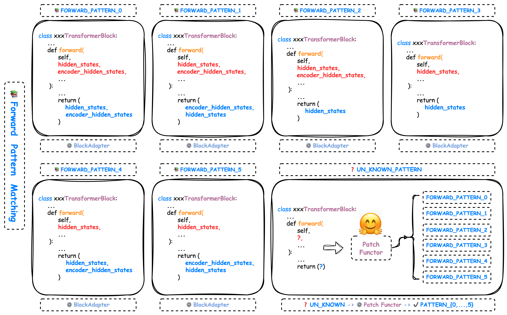

## Cache Acceleration with One-line Code

In most cases, you only need to call **one-line** of code, that is <span style="color:#c77dff;">enable_cache</span>. After this API is called, you just need to call the pipe as normal. The `pipe` param can be **any** Diffusion Pipeline. Please refer to [Qwen-Image](https://github.com/vipshop/cache-dit/blob/main/examples/run_qwen_image.py) as an example. 

```python
import cache_dit
from diffusers import DiffusionPipeline 

# Can be any diffusion pipeline
pipe = DiffusionPipeline.from_pretrained("Qwen/Qwen-Image")
# One-line code with default cache options.
cache_dit.enable_cache(pipe) 
# Just call the pipe as normal.
output = pipe(...)
# Disable cache and run original pipe.
cache_dit.disable_cache(pipe)
```

## Automatic Block Adapter

But in some cases, you may have a **modified** Diffusion Pipeline or Transformer that is not located in the diffusers library or not officially supported by **cache-dit** at this time. The **<span style="color:#c77dff;">BlockAdapter</span>** can help you solve this problems. Please refer to [🔥Qwen-Image w/ BlockAdapter](https://github.com/vipshop/cache-dit/blob/main/examples/adapter/run_qwen_image_adapter.py) as an example.

```python
from cache_dit import ForwardPattern, BlockAdapter

# Use 🔥BlockAdapter with `auto` mode.
cache_dit.enable_cache(
  BlockAdapter(
    # Any DiffusionPipeline, Qwen-Image, etc.  
    pipe=pipe, auto=True,
    # Check `📚Forward Pattern Matching` documentation and hack the code of
    # of Qwen-Image, you will find that it has satisfied `FORWARD_PATTERN_1`.
    forward_pattern=ForwardPattern.Pattern_1,
  ),   
)

# Or, manually setup transformer configurations.
cache_dit.enable_cache(
  BlockAdapter(
    pipe=pipe, # Qwen-Image, etc.
    transformer=pipe.transformer,
    blocks=pipe.transformer.transformer_blocks,
    forward_pattern=ForwardPattern.Pattern_1,
  ), 
)
```
For such situations, **<span style="color:#c77dff;">BlockAdapter</span>** can help you quickly apply various cache acceleration features to your own Diffusion Pipelines and Transformers. 

## Hybrid Forward Pattern

Sometimes, a Transformer class will contain more than one transformer `blocks`. For example, **FLUX.1** (HiDream, Chroma, etc) contains transformer_blocks and single_transformer_blocks (with different **<span style="color:#c77dff;">Forward Patterns</span>**). The **<span style="color:#c77dff;">BlockAdapter</span>** can also help you solve this problem. 
```python
# For diffusers <= 0.34.0, FLUX.1 transformer_blocks and 
# single_transformer_blocks have different forward patterns.
cache_dit.enable_cache(
  BlockAdapter(
    pipe=pipe, # FLUX.1, etc.
    transformer=pipe.transformer,
    blocks=[
      pipe.transformer.transformer_blocks,
      pipe.transformer.single_transformer_blocks,
    ],
    forward_pattern=[
      ForwardPattern.Pattern_1,
      ForwardPattern.Pattern_3,
    ],
  ),
)
```

Even sometimes you have more complex cases, such as **Wan 2.2 MoE**, which has <span style="color:#c77dff;">more than one Transformer</span> (namely `transformer` and `transformer_2`) in its structure. Fortunately, **cache-dit** can also handle this situation very well. Please refer to [📚Wan 2.2 MoE](https://github.com/vipshop/cache-dit/blob/main/examples) as an example.

```python
from cache_dit import ForwardPattern, BlockAdapter, ParamsModifier, DBCacheConfig

cache_dit.enable_cache(
  BlockAdapter(
    pipe=pipe,
    transformer=[
      pipe.transformer,
      pipe.transformer_2,
    ],
    blocks=[
      pipe.transformer.blocks,
      pipe.transformer_2.blocks,
    ],
    forward_pattern=[
      ForwardPattern.Pattern_2,
      ForwardPattern.Pattern_2,
    ],
    # Setup different cache params for each 'blocks'. You can 
    # pass any specific cache params to ParamModifier, the old 
    # value will be overwrite by the new one.
    params_modifiers=[
      ParamsModifier(
        cache_config=DBCacheConfig().reset(
          max_warmup_steps=4,
          max_cached_steps=8,
        ),
      ),
      ParamsModifier(
        cache_config=DBCacheConfig().reset(
          max_warmup_steps=2,
          max_cached_steps=20,
        ),
      ),
    ],
    has_separate_cfg=True,
  ),
)
```

## Implement Patch Functor

For any PATTERN not in <span style="color:#c77dff;">{0...5}</span>, we introduced the simple abstract concept of **<span style="color:#c77dff;">Patch Functor</span>**. Users can implement a subclass of Patch Functor to convert an unknown Pattern into a known PATTERN, and for some models, users may also need to fuse the operations within the blocks for loop into block forward. 

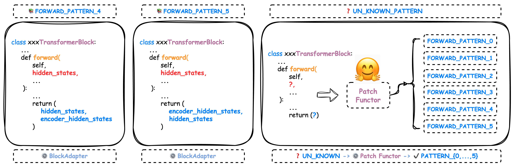

Some Patch functors have already been provided in cache-dit: [📚HiDreamPatchFunctor](https://github.com/vipshop/cache-dit/blob/main/src/cache_dit/caching/patch_functors/functor_hidream.py), [📚ChromaPatchFunctor](https://github.com/vipshop/cache-dit/blob/main/src/cache_dit/caching/patch_functors/functor_chroma.py), etc. After implementing Patch Functor, users need to set the `patch_functor` property of **<span style="color:#c77dff;">BlockAdapter</span>**.

```python
@BlockAdapterRegister.register("HiDream")
def hidream_adapter(pipe, **kwargs) -> BlockAdapter:
  from diffusers import HiDreamImageTransformer2DModel
  from cache_dit.caching.patch_functors import HiDreamPatchFunctor

  assert isinstance(pipe.transformer, HiDreamImageTransformer2DModel)
  return BlockAdapter(
    pipe=pipe,
    transformer=pipe.transformer,
    blocks=[
      pipe.transformer.double_stream_blocks,
      pipe.transformer.single_stream_blocks,
    ],
    forward_pattern=[
      ForwardPattern.Pattern_0,
      ForwardPattern.Pattern_3,
    ],
    # NOTE: Setup your custom patch functor here.
    patch_functor=HiDreamPatchFunctor(),
    **kwargs,
  )
```

## Transformer-Only Interface

In some cases, users may <span style="color:#c77dff;">not use Diffusers</span> or DiffusionPipeline at all, and may not even have the concept of a "pipeline"—for instance, **<span style="color:#c77dff;">ComfyUI</span>** (which breaks down the pipeline into individual components while still retaining transformer components). cache-dit also supports such scenarios; it only needs to be configured via **<span style="color:#c77dff;">BlockAdapter</span>**. The pipeline is not mandatory, and you can simply keep it at the default value of None. In this case, the <span style="color:#c77dff;">num_inference_steps</span> parameter in cache_config **must be set**, as cache-dit relies on this parameter to refresh the cache context at the appropriate time. Please refer to [📚run_transformer_only.py](https://github.com/vipshop/cache-dit/blob/main/examples/api/run_transformer_only.py) as an example.

```python
cache_dit.enable_cache(
  BlockAdapter( 
    # NO `pipe` required
    transformer=transformer,
    blocks=transformer.transformer_blocks,
    forward_pattern=ForwardPattern.Pattern_1,
  ), 
  cache_config=DBCacheConfig(
    num_inference_steps=50  # required
  ),
)
```

If you need to use a **different** num_inference_steps for each user request instead of a fixed value, you should use it in conjunction with <span style="color:#c77dff;">refresh_context</span> API. Before performing inference for each user request, update the cache context based on the actual number of steps. Please refer to [📚run_cache_refresh](https://github.com/vipshop/cache-dit/blob/main/examples/api) as an example.

```python
import cache_dit
from cache_dit import DBCacheConfig
from diffusers import DiffusionPipeline

# Init cache context with num_inference_steps=None (default)
pipe = DiffusionPipeline.from_pretrained("Qwen/Qwen-Image")
pipe = cache_dit.enable_cache(pipe.transformer, cache_config=DBCacheConfig(num_inference_steps=None))

# Assume num_inference_steps is 28, and we want to refresh the context
cache_dit.refresh_context(pipe.transformer, num_inference_steps=28, verbose=True)
output = pipe(...) # Just call the pipe as normal.
stats = cache_dit.summary(pipe.transformer) # Then, get the summary

# Update the cache context with new num_inference_steps=50.
cache_dit.refresh_context(pipe.transformer, num_inference_steps=50, verbose=True)
output = pipe(...) # Just call the pipe as normal.
stats = cache_dit.summary(pipe.transformer) # Then, get the summary

# Update the cache context with new cache_config.
cache_dit.refresh_context(
  pipe.transformer,
  cache_config=DBCacheConfig(
    residual_diff_threshold=0.1,
    max_warmup_steps=10,
    max_cached_steps=20,
    max_continuous_cached_steps=4,
    # The cache settings should all be located in the cache config 
    # if cache config is provided. Otherwise, we will skip it.
    num_inference_steps=50,
  ),
  verbose=True,
)
output = pipe(...) # Just call the pipe as normal.
stats = cache_dit.summary(pipe.transformer) # Then, get the summary
```

## How to use ParamsModifier

Sometimes you may encounter more complex cases, such as **Wan 2.2 MoE**, which has more than one Transformer (namely `transformer` and `transformer_2`), or FLUX.1, which has multiple transformer blocks (namely `single_transformer_blocks` and `transformer_blocks`). cache-dit will assign separate cache contexts for different `blocks` instances but share the same `cache_config` by default. Users who want to achieve fine-grained control over different cache contexts can consider using <span style="color:#c77dff;">ParamsModifier</span>. Just pass the <span style="color:#c77dff;">ParamsModifier</span> per `blocks` to the `BlockAdapter` or `enable_cache(...)` API. Then, the shared `cache_config` will be overwritten by the new configurations from the <span style="color:#c77dff;">ParamsModifier</span>. For example:

```python
from cache_dit import ParamsModifier 

cache_dit.enable_cache(
  BlockAdapter(
    pipe=pipe, # FLUX.1, etc.
    transformer=pipe.transformer,
    blocks=[
      pipe.transformer.transformer_blocks,
      pipe.transformer.single_transformer_blocks,
    ],
    forward_pattern=[
      ForwardPattern.Pattern_1,
      ForwardPattern.Pattern_3,
    ],
  ),
  # Basic shared cache config 
  cache_config=DBCacheConfig(...),
  params_modifiers=[
    ParamsModifier(
      # Modified config only for transformer_blocks
      # Must call the `reset` method of DBCacheConfig.
      cache_config=DBCacheConfig().reset(
        Fn_compute_blocks=8,
        residual_diff_threshold=0.08,
      ),
    ),
    ParamsModifier(
      # Modified config only for single_transformer_blocks
      # NOTE: FLUX.1, single_transformer_blocks should have `higher` 
      # residual_diff_threshold because of the precision error 
      # accumulation from previous transformer_blocks
      cache_config=DBCacheConfig().reset(
        Fn_compute_blocks=1,
        residual_diff_threshold=0.16,
      ),
    ),
  ],
)
```

## Cache Stats Summary

After finishing each inference of `pipe(...)`, you can call the <span style="color:#c77dff;">summary</span> API on pipe to get the details of the **Cache Acceleration Stats** for the current inference. 
```python
stats = cache_dit.summary(pipe)
```

You can set `details` param as `True` to show more details of cache stats. (markdown table format) Sometimes, this may help you analyze what values of the residual diff threshold would be better.

```python
⚡️Cache Steps and Residual Diffs Statistics: QwenImagePipeline

| Cache Steps | Diffs Min | Diffs P25 | Diffs P50 | Diffs P75 | Diffs P95 | Diffs Max |
|-------------|-----------|-----------|-----------|-----------|-----------|-----------|
| 23          | 0.045     | 0.084     | 0.114     | 0.147     | 0.241     | 0.297     |
```

## Disable Cache Acceleration

Users can call <span style="color:#c77dff;">disable_cache</span> API to disable and delete the all acceleration hooks from the optimized pipeline or block adapter. 

```python
import cache_dit
# Disable all acceleration and run the original pipe.
cache_dit.disable_cache(pipe_or_adapter)
```

## DBCache: Dual Block Cache  

<div id="dbcache"></div>

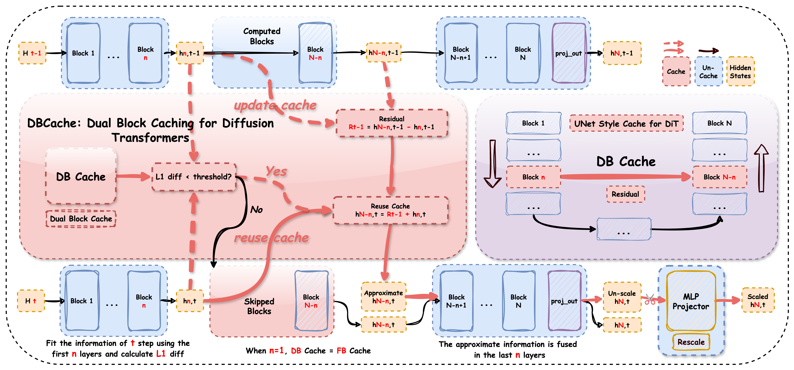

**<span style="color:#c77dff;">DBCache: Dual Block Caching</span>** for Diffusion Transformers. Different configurations of compute blocks (**F8B12**, etc.) can be customized in <span style="color:#c77dff;">DBCache</span>, enabling a balanced trade-off between performance and precision. Moreover, it can be entirely **training**-**free**. Please check [DBCache Design](./DBCACHE_DESIGN.md) docs for more design details.

- **<span style="color:#c77dff;">Fn</span>**: Specifies that DBCache uses the **first n** Transformer blocks to fit the information at time step t, enabling the calculation of a more stable L1 diff and delivering more accurate information to subsequent blocks.
- **<span style="color:#c77dff;">Bn</span>**: Further fuses approximate information in the **last n** Transformer blocks to enhance prediction accuracy. These blocks act as an auto-scaler for approximate hidden states that use residual cache.

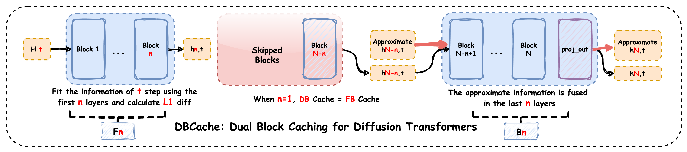

```python
import cache_dit
from diffusers import FluxPipeline

pipe_or_adapter = FluxPipeline.from_pretrained(
  "black-forest-labs/FLUX.1-dev",
  torch_dtype=torch.bfloat16,
).to("cuda")

# Default options, F8B0, 8 warmup steps, and unlimited cached 
# steps for good balance between performance and precision
cache_dit.enable_cache(pipe_or_adapter)

# Custom options, F8B8, higher precision
from cache_dit import DBCacheConfig

cache_dit.enable_cache(
  pipe_or_adapter,
  cache_config=DBCacheConfig(
    max_warmup_steps=8,  # steps do not cache
    max_cached_steps=-1, # -1 means no limit
    Fn_compute_blocks=8, # Fn, F8, etc.
    Bn_compute_blocks=8, # Bn, B8, etc.
    residual_diff_threshold=0.12,
  ),
)
```  

<div align="center">
  <p align="center">
  DBCache, <b> L20x1 </b>, Steps: 28, "A cat holding a sign that says hello world with complex background"
  </p>
</div>


|Baseline(L20x1)|F1B0 (0.08)|F1B0 (0.20)|F8B8 (0.15)|F12B12 (0.20)|
|:---:|:---:|:---:|:---:|:---:|
|24.85s|15.59s|8.58s|15.41s|15.11s|
|| | |||
|**Baseline(L20x1)**|**F1B0 (0.08)**|**F8B8 (0.12)**|**F8B12 (0.12)**|**F8B16 (0.20)**|
|27.85s|6.04s|5.88s|5.77s|6.01s|
|| ||||


<div align="center">
  <p align="center">
  DBCache, <b> L20x4 </b>, Steps: 20, case to show the texture recovery ability of DBCache
  </p>
</div>

These case studies demonstrate that even with relatively high thresholds (such as 0.12, 0.15, 0.2, etc.) under the DBCache **F12B12** or **F8B16** configuration, the detailed texture of the kitten's fur, colored cloth, and the clarity of text can still be preserved. This suggests that users can leverage DBCache to effectively balance performance and precision in their workflows! 


## SeaCache Probe: SEA-filtered Relative L1

<div id="seacache"></div>

**<span style="color:#c77dff;">SeaCache</span>** ([Spectral-Evolution-Aware Cache](https://arxiv.org/abs/2602.18993)) is an optional **probe metric inside DBCache**, not a separate `CacheType` or calibrator. It applies a time-varying, mean-normalized Wiener/SEA filter before the existing relative-L1 decision:

$$G_t(f)=\frac{a_tS_x(f)}{a_t^2S_x(f)+b_t^2},\qquad \widetilde{\Delta}=\operatorname{RelL1}(\mathcal P(G_{prev},I_{prev}),\mathcal P(G_t,I_t))$$

The default `enable_seacache=False` preserves the original DBCache path, patchable `similarity()` function, buffers, artifact names, and decisions. The dedicated `seacache_similarity()` entry is selected only when explicitly enabled. Fn/Bn, cached values, warmup, masks, calibrators, and all cache guards are unchanged.

```python
from cache_dit import DBCacheConfig

cache_dit.enable_cache(
  pipe,  # Any pipeline with a compatible scheduler and known feature geometry.
  cache_config=DBCacheConfig(
    Fn_compute_blocks=1,
    Bn_compute_blocks=0,
    residual_diff_threshold=0.12,
    enable_seacache=True,
    seacache_mode="flow",  # "flow": a=1-sigma, b=sigma; "vp" uses alphas_cumprod.
    seacache_feature_shape=(64, 64),  # Global packed-token H,W; video uses F,H,W.
    seacache_power_exp=2.0,  # 2 for images; 3 is a common video prior.
  ),
)
```

For dense BCHW/BCTHW probes, existing spatial dimensions are used directly. Packed `[B,S,C]` probes must provide `seacache_feature_shape`; its product must equal the global token count. Transformer-only or custom schedulers can bypass scheduler discovery with `seacache_ab_schedule=((a0,b0), (a1,b1), ...)`. Missing coefficients or incompatible geometry raise an error instead of silently using raw L1.

CP restores the complete token geometry with the existing CP mesh before FFT, including uneven Ulysses-Anything shards. TP filters channel shards independently, and CP+TP composes both; the existing distributed reduction keeps rank decisions consistent. These opt-in communications and the separate raw/filtered anchors add memory and runtime cost. The original DBCache distributed path performs no additional communication.

The official FLUX implementation probes the first block's modulated input. Its reference code implements the paper's radial response as a separable per-axis product, which this module follows. The cache-dit integration filters the existing Fn residual/hidden-state probe and retains DBCache scheduling; it is an adaptation of the SEA metric, not a reproduction of the official whole-step execution path.

```bash
python3 -m cache_dit.generate flux --cache --seacache \
  --seacache-mode flow --seacache-feature-shape 64 64 --seacache-power-exp 2.0
```

A FLUX.1-dev probe (1024², 28 steps, seed 0, compile+F1B0+warmup 8, RTX PRO 5000) produced:

| Config | Latency | Cache Steps | PSNR vs compile | SSIM vs compile |
|:--|--:|--:|--:|--:|
| DBCache reuse, rdt=0.12 | 8.67s | 12 | 28.09 | 0.9643 |
| SeaCache, rdt=0.12 | 11.77s | 6 | 29.52 | 0.9749 |
| SeaCache, rdt=0.24 | 8.19s | 13 | 27.80 | 0.9576 |
| SeaCache, rdt=0.24 repeat | 8.18s | 13 | 28.89 | 0.9575 |

The rdt=0.24 same-config repeat was 33.46dB/0.9887 SSIM. Ulysses CP2 completed with 12 hits for reuse (5.77s) and 6 for SeaCache (7.81s), with identical SEA diff distributions to the single-card run. These single-prompt results are wiring probes: at the same threshold SeaCache cached fewer steps and paid FFT/communication cost, so they do not establish a universal speed or quality benefit.

## Hybrid Cache CFG

<div id="cfg"></div>

cache-dit supports caching for **<span style="color:#c77dff;">CFG (classifier-free guidance)</span>**. For models that fuse CFG and non-CFG into a single forward step, or models that do not include CFG (classifier-free guidance) in the forward step, please set <span style="color:#c77dff;">enable_separate_cfg</span> param to **False (default, None)**. Otherwise, set it to True. For examples:

```python
from cache_dit import DBCacheConfig

cache_dit.enable_cache(
  pipe_or_adapter, 
  cache_config=DBCacheConfig(
    ...,
    # CFG: classifier free guidance or not
    # For model that fused CFG and non-CFG into single forward step,
    # should set enable_separate_cfg as False. For example, set it as True 
    # for Wan 2.1/Qwen-Image and set it as False for FLUX.1, HunyuanVideo, 
    # CogVideoX, Mochi, LTXVideo, Allegro, CogView3Plus, EasyAnimate, SD3, etc.
    enable_separate_cfg=True, # Wan 2.1, Qwen-Image, CogView4, Cosmos, SkyReelsV2, etc.
    # Compute cfg forward first or not, default False, namely, 
    # 0, 2, 4, ..., -> non-CFG step; 1, 3, 5, ... -> CFG step.
    cfg_compute_first=False,
    # Compute separate diff values for CFG and non-CFG step, 
    # default True. If False, we will use the computed diff from 
    # current non-CFG transformer step for current CFG step.
    cfg_diff_compute_separate=True,
  ),
)
```

## TaylorSeer Calibrator: Taylor Series Extrapolation

<div id="taylorseer"></div>

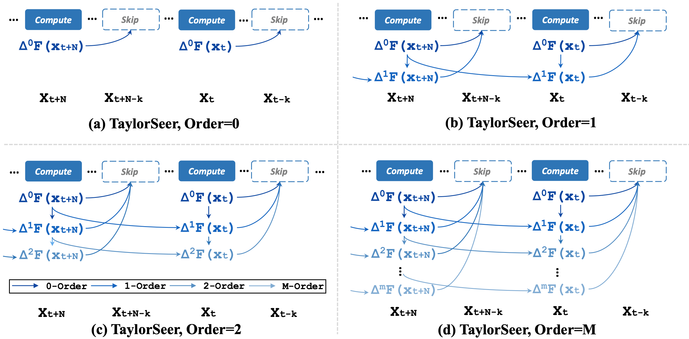

We have supported the [TaylorSeers: From Reusing to Forecasting: Accelerating Diffusion Models with TaylorSeers](https://arxiv.org/pdf/2503.06923) algorithm to further improve the precision of DBCache in cases where the cached steps are large, namely, **<span style="color:#c77dff;">Hybrid TaylorSeer + DBCache</span>**. At timesteps with significant intervals, the feature similarity in diffusion models decreases substantially, significantly harming the generation quality. 

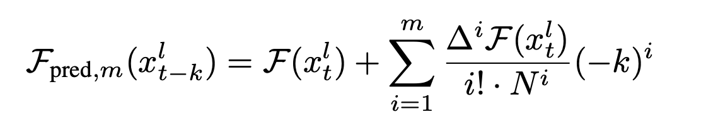

**<span style="color:#c77dff;">TaylorSeer</span>** employs a differential method to approximate the higher-order derivatives of features and predict features in future timesteps with Taylor series expansion. The TaylorSeer implemented in cache-dit supports both hidden states and residual cache types. That F_pred can be a residual cache or a hidden-state cache.

```python
from cache_dit import DBCacheConfig, TaylorSeerCalibratorConfig

cache_dit.enable_cache(
  pipe_or_adapter,
  # Basic DBCache w/ FnBn configurations
  cache_config=DBCacheConfig(
    max_warmup_steps=8,  # steps do not cache
    max_cached_steps=-1, # -1 means no limit
    Fn_compute_blocks=8, # Fn, F8, etc.
    Bn_compute_blocks=8, # Bn, B8, etc.
    residual_diff_threshold=0.12,
  ),
  # Then, you can use the TaylorSeer Calibrator to approximate 
  # the values in cached steps, taylorseer_order default is 1.
  calibrator_config=TaylorSeerCalibratorConfig(
    taylorseer_order=1,
  ),
)
``` 

Please note that if you have used TaylorSeer as the calibrator for approximate hidden states, the **Bn** param of DBCache can be set to **0**. In essence, DBCache's Bn is also act as a calibrator, so you can choose either Bn > 0 or TaylorSeer. We recommend using the configuration scheme of **<span style="color:#c77dff;">TaylorSeer</span>** + **<span style="color:#c77dff;">DBCache FnB0</span>**.

<div align="center">
  <p align="center">
  <b>DBCache F1B0 + TaylorSeer</b>, L20x1, Steps: 28, <br>"A cat holding a sign that says hello world with complex background"
  </p>
</div>

|Baseline(L20x1)|F1B0 (0.12)|+TaylorSeer|F1B0 (0.15)|+TaylorSeer +compile|  
|:---:|:---:|:---:|:---:|:---:|
|24.85s|12.85s|12.86s|10.27s|8.48s|
||||||

## HiCache Calibrator: Damped Hermite Basis

<div id="hicache"></div>

**<span style="color:#c77dff;">HiCache</span>** ([HiCache: Accelerating Diffusion Models with Hermite Feature Caching](https://arxiv.org/abs/2508.16984)) keeps TaylorSeer's finite-difference ladder and replaces **only** the extrapolation basis:

$$\hat{Y}(t) = Y(0) + \sum_{k=1}^{N} \frac{1}{k!} \Delta^k Y \cdot \tilde{H}_k(t), \qquad \tilde{H}_k(t) = \sigma^k H_k(\sigma t)$$

where $H_k$ is the physicist Hermite polynomial ($H_0=1$, $H_1=2x$, $H_{k+1}=2xH_k-2kH_{k-1}$). Every higher order is damped by $\sigma^2$ — the first-order gain is $2\sigma^2$ instead of Taylor's $1$ — so the extrapolation stays bounded over the longer skip intervals where a raw polynomial diverges. The finite differences $\Delta^kY$ are computed by exactly the same code as TaylorSeer.

```python
from cache_dit import DBCacheConfig, HiCacheCalibratorConfig

cache_dit.enable_cache(
  pipe_or_adapter,
  cache_config=DBCacheConfig(
    max_warmup_steps=8,
    max_cached_steps=-1,
    Fn_compute_blocks=8,
    Bn_compute_blocks=0,  # Bn=0 since the calibrator replaces Bn
    residual_diff_threshold=0.12,
  ),
  calibrator_config=HiCacheCalibratorConfig(
    hicache_order=2,    # N_order, capped at 4
    hicache_sigma=0.5,  # 0.4-0.5 in the paper
  ),
)
```

The same selection from the CLI:

```bash
python3 -m cache_dit.generate flux --cache --calibrator hicache \
  --calibrator-params order=2,sigma=0.5
```

Two facts change how the paper's numbers transfer, and they are not implementation details:

- **The schedule still comes from DBCache.** The paper refreshes on a fixed interval $N_{interval}$ and caches per-layer features. cache-dit keeps its adaptive `residual_diff_threshold` and its block granularity, so `elapsed` and the ladder spacing vary per hit. The sum is therefore a **basis substitution**, not a Hermite interpolation of uniformly spaced samples.
- **`sigma` is coupled to the cache aggressiveness and must be re-swept per model.** The paper calibrates it at a fixed interval on FLUX (0.4-0.5). `sigma = 1` keeps the *undamped* Hermite basis and is measurably worse than TaylorSeer in the paper's own ablation, while `sigma = 1/\sqrt{2}` makes the first-order term identical to Taylor's — neither is a drop-in default.

Measured (FLUX.1-dev, 1024², 28 steps, prompt "A cat holding a sign that says hello world", seed 0, `residual_diff_threshold=0.12`, 12 of 28 steps cached at **identical positions** in every row so the schedule is not a confounder; 1× RTX PRO 5000, torch 2.15.0, single prompt — a wiring probe, not a benchmark):

| Config | PSNR (dB) | SSIM | Latency |
|:--|:--:|:--:|:--:|
| DBCache reuse (`rdt 0.12`) | 31.72 | 0.9706 | 9.88s |
| + TaylorSeer (order 2) | 30.91 | 0.9733 | 9.88s |
| + HiCache (order 2, σ=0.4) | 33.10 | 0.9765 | 9.89s |
| + HiCache (order 2, σ=0.5) | **33.33** | **0.9781** | 9.88s |
| + HiCache (order 1, σ=0.5) | 33.36 | 0.9779 | 9.91s |
| + HiCache (order 2, σ=1/√2) | 32.44 | 0.9770 | 9.88s |
| + HiCache (order 2, σ=1.0) | 24.99 | 0.9280 | 9.89s |

Two readings: the **damping is what carries the gain** — the undamped basis (σ=1) collapses to 25 dB, the same direction as the paper's σ ablation, which is the cheapest proof that the basis is wired and not silently falling back to TaylorSeer; and within this probe **order 1 is already enough at ~1.7×**. A mask-pinned pair (`--steps-mask --mask-policy medium`, 9 cached steps, schedule independent of the forecast) keeps the ordering (TaylorSeer 27.77 dB vs HiCache 29.36 dB), so the gap comes from the basis rather than from a shifted hit sequence. The `+ compile` row lands at 27.5-28.2 dB and differs run to run, as with every calibrator under `torch.compile`.

<details markdown="1">
<summary>📖 HiCache Config Parameters</summary>

| Parameter | Type | Default | Description |
|:---|:---|:---|:---|
| `hicache_order` | `int` | 2 | Highest finite-difference/Hermite order kept (the paper's $N_{order}$, capped at 4). `0` reproduces plain anchor reuse. |
| `hicache_sigma` | `float` | 0.5 | Damping factor of the Hermite basis, in (0, 1]. The paper uses 0.4-0.5. |
| `enable_calibrator` | `bool` | True | Whether to enable the calibrator for hidden states. |
| `enable_encoder_calibrator` | `bool` | True | Whether to enable the calibrator for encoder hidden states. |

</details>

## BRACE Calibrator: Barycentric Rational Forecasting

<div id="brace"></div>

**<span style="color:#c77dff;">BRACE</span>** ([BRACE: Taming Sharp Irregularities via Barycentric Rational Forecasting for Fast Diffusion Transformers Inference](https://arxiv.org/abs/2608.07572)) is an experimental, derivative-free calibrator. It keeps a FIFO of at most three real full-compute anchors and evaluates the second barycentric form:

$$x(\tau)=2\frac{\tau-\tau_{min}}{\tau_{max}-\tau_{min}}-1,\qquad F_{pred}=\frac{\sum_j w_jF_j/(x_{pred}-x_j)}{\sum_j w_j/(x_{pred}-x_j)}$$

The adapted Chebyshev weights are $w_j=(-1)^{j+1}\delta_j$, with $\delta_1=1/2$, $\delta_C=\gamma$, and all intermediate $\delta_j=1$. The defaults are $C=3$ and $\gamma=0.7$. While the window is filling, $C$ means its effective current length; $C=1$ is exact anchor reuse.

```python
from cache_dit import DBCacheConfig, BRACECalibratorConfig

cache_dit.enable_cache(
  pipe_or_adapter,
  cache_config=DBCacheConfig(
    max_warmup_steps=8,
    max_cached_steps=-1,
    Fn_compute_blocks=1,
    Bn_compute_blocks=0,
    residual_diff_threshold=0.12,
  ),
  calibrator_config=BRACECalibratorConfig(
    brace_capacity=3,
    brace_gamma=0.7,
  ),
)
```

The same selection from the CLI:

```bash
python3 -m cache_dit.generate flux --cache --calibrator brace \
  --calibrator-params capacity=3,gamma=0.7
```

cache-dit ports only the predictor. DBCache still owns the adaptive cache decision and block granularity; the paper's fixed refresh interval and per-layer cache are not reproduced. Logical step indices replace scheduler timesteps because the calibrator interface has no scheduler input. This supports non-uniform anchor spacing, but it is not the same coordinate system as a non-uniform scheduler's raw timesteps. Predictions never enter the FIFO, so repeated queries within one step are idempotent.

The scalar denominator is checked for cancellation. A non-finite or relatively near-zero denominator falls back to the latest real anchor, increments `num_fallbacks`, and emits a warning on the first occurrence. Normal runs should have zero fallbacks. $\gamma$ is restricted to $[0.5,\infty)$ because smaller values introduce extrapolation poles; $\gamma=0.5$ is the canonical Chebyshev weighting. The paper selects $\gamma=0.7$ using perceptual quality even though PSNR/SSIM can improve as $\gamma$ approaches 1; do not tune gamma from PSNR/SSIM alone.

A FLUX.1-dev wiring probe (1024², 28 steps, seed 0, one prompt, compile+F1B0+`rdt=0.12`, RTX PRO 5000, torch 2.15.0) produced 12 Cache Steps in every row and no BRACE fallback:

| Config | Latency | PSNR vs compile | SSIM vs compile |
|:--|--:|--:|--:|
| DBCache reuse | 8.65s | 29.03 | 0.9614 |
| + TaylorSeer order 1 | 8.66s | 31.52 | 0.9740 |
| + BRACE C=2, gamma=0.7 | 8.65s | 29.57 | 0.9720 |
| + BRACE C=3, gamma=0.7 | 8.66s | 30.75 | 0.9743 |

This is a single-prompt compile probe, not a predictor ranking: high-acceleration, multi-prompt, and multi-backbone validation remain necessary.

<details markdown="1">
<summary>📖 BRACE Config Parameters</summary>

| Parameter | Type | Default | Description |
|:---|:---|:---|:---|
| `brace_capacity` | `int` | 3 | Real-anchor FIFO capacity, in {1, 2, 3}. `1` reproduces plain reuse. |
| `brace_gamma` | `float` | 0.7 | Finite terminal weight in $[0.5,\infty)$; smaller values are rejected because they admit extrapolation poles. |
| `enable_calibrator` | `bool` | True | Whether to enable the calibrator for hidden states. |
| `enable_encoder_calibrator` | `bool` | True | Whether to enable the calibrator for encoder hidden states. |

</details>

## BeziCast Calibrator: Bernstein/Bezier Forecasting

<div id="bezicast"></div>

**<span style="color:#c77dff;">BeziCast</span>** ([Beyond Linear Extrapolation: Training-Free Bezier Trajectories for Feature Caching in Diffusion Transformers](https://arxiv.org/abs/2610.16448)) is an experimental calibrator for non-uniform historical anchors. It fits a ridge-stabilized Bernstein design and applies the resulting equivalent weights directly to real full-compute tensors:

$$w(u)=b(u)^T(A^TA+\lambda I)^{-1}A^T,\qquad Z_{pred}=\sum_m w_m Z_m$$

The pure-predictor defaults follow the paper: `history=6`, `control_points=4`, and `ridge=0.5`. Logical step indices provide the coordinates; only real `update()` values enter the FIFO. A zero ridge uses the minimum-norm pseudoinverse, while a positive ridge solves the stabilized normal system.

```python
from cache_dit import DBCacheConfig, BeziCastCalibratorConfig

cache_dit.enable_cache(
  pipe_or_adapter,
  cache_config=DBCacheConfig(
    max_warmup_steps=4,
    max_cached_steps=-1,
    Fn_compute_blocks=1,
    Bn_compute_blocks=0,
    residual_diff_threshold=0.12,
  ),
  calibrator_config=BeziCastCalibratorConfig(),
)
```

```bash
python3 -m cache_dit.generate flux --cache --calibrator bezicast \
  --calibrator-params history=6,control_points=4,ridge=0.5,guardrail=false
```

The optional equivalent-weight guardrail implements the paper's risk score, Euclidean probability-simplex projection, and soft blending:

$$r=|\sum_m w_m-1|+\left(\sum_m|w_m|-|\sum_m w_m|\right)$$
$$Z_{pred}=(1-\beta)Z_{raw}+\beta Z_{simplex}$$

The paper recommends its simplex guardrail but does not report a universal threshold setting. cache-dit keeps it **opt-in** because the local FLUX probe did not show a consistent gain. Use `guardrail=true,rho=auto` to measure the current design's risk at the window edge `u=1`; alternatively set a numeric `rho`. `u_max=1.5` is a conservative cache-dit query cap, not a paper-reported universal default.

When fewer than `control_points` real anchors exist, the paper forces an extra full compute. `CalibratorBase` cannot change DBCache's scheduling decision, so this adaptation explicitly reuses the latest real anchor and increments `num_warmup_reuses`. Other diagnostics include `num_forecasts`, `num_numerical_fallbacks`, `num_guardrail_calls`, `num_query_clips`, `mean_guardrail_beta`, and `max_last_risk`. Normal numerical operation should have zero numerical fallbacks.

A FLUX.1-dev probe (1024², 28 steps, seed 0, compile+F1B0+`rdt=0.12`, RTX PRO 5000, torch 2.15.0) produced 12 Cache Steps in every row and no BeziCast numerical fallback:

| Config | Latency | PSNR vs compile | SSIM vs compile |
|:--|--:|--:|--:|
| DBCache reuse | 8.65s | 29.61 | 0.9634 |
| + TaylorSeer order 1 | 8.67s | 30.60 | 0.9698 |
| + BRACE C=3 | 8.65s | 29.42 | 0.9699 |
| + BeziCast guardrail off | 8.67s | 30.56 | 0.9670 |
| + BeziCast guardrail on, rho=auto | 8.68s | 30.46 | 0.9650 |

Same-config repeat PSNR/SSIM was 39.60/0.9932 with guardrail off and 32.58/0.9873 with guardrail on. This single-prompt compile probe is not a universal predictor ranking; guardrail-on did not demonstrate a stable benefit.

<details markdown="1">
<summary>📖 BeziCast Config Parameters</summary>

| Parameter | Type | Default | Description |
|:---|:---|:---|:---|
| `bezicast_history` | `int` | 6 | Real-anchor FIFO capacity, in [2, 6]. |
| `bezicast_control_points` | `int` | 4 | Bernstein control points, in [2, history]. |
| `bezicast_ridge` | `float` | 0.5 | Non-negative Tikhonov coefficient; 0 selects `pinv` interpolation. |
| `bezicast_guardrail` | `bool` | False | Enable risk-based blending toward simplex-projected weights. |
| `bezicast_u_max` | `float` | 1.5 | Normalized query cap, at least 1. |
| `bezicast_beta_max` | `float` | 1.0 | Maximum guardrail blend, in [0, 1]. |
| `bezicast_rho` | `float \| None` | None | Risk threshold; None measures risk at `u=1`. CLI: `rho=auto`. |
| `bezicast_gamma` | `float` | 1.0 | Positive guardrail transition width. |
| `enable_calibrator` | `bool` | True | Enable the calibrator for hidden states. |
| `enable_encoder_calibrator` | `bool` | True | Enable the calibrator for encoder hidden states. |

</details>

## Residual Motion Calibrator: Sigma-Secant Extrapolation

<div id="residual-motion"></div>

**<span style="color:#c77dff;">Residual Motion</span>** ([SoftCache: Adaptive Step Size Caching for Diffusion Transformers](https://arxiv.org/abs/2610.22369), [code](https://github.com/ShimonMalnick/softcache)) is the predictor of SoftCache. It moves the cached residual along the secant of the last two real anchors, measured in the flow-matching sigma rather than the step count:

$$r(\sigma)=r_a+\beta\,\lambda\,(r_a-r_{a-1}),\qquad \lambda=\frac{\sigma-\sigma_a}{\sigma_a-\sigma_{a-1}}$$

With one real anchor it reuses that residual as is. Sigma coordinates keep the extrapolation right when the sigma grid is non-uniform, which is what SoftCache's jumps produce. It is not a better general calibrator. On plain DBCache it measured 0.5–1 dB PSNR below TaylorSeer order 1 at the same Cache Steps (table below), so for plain DBCache TaylorSeer remains the default pick. It needs a scheduler with flow-matching `sigmas`, read at the same step index SeaCache uses. With a pipeline this is `pipe.scheduler`. For transformer-only caching pass `residual_motion_scheduler=` to `enable_cache` along with `num_inference_steps`.

```python
from cache_dit import DBCacheConfig, ResidualMotionCalibratorConfig

cache_dit.enable_cache(
  pipe_or_adapter,
  cache_config=DBCacheConfig(
    max_warmup_steps=4,
    max_cached_steps=-1,
    Fn_compute_blocks=1,
    Bn_compute_blocks=0,
    residual_diff_threshold=0.12,
  ),
  calibrator_config=ResidualMotionCalibratorConfig(),
)
```

```bash
python3 -m cache_dit.generate flux --cache --calibrator residual_motion --calibrator-params beta=1.0
```

FLUX.1-dev, 1024², 50 steps, guidance 3.5, 8 DPG prompts, A100-40GB, bf16, no compile, DBCache F1B0 with the default warmup. PSNR / SSIM / LPIPS are against the uncached 50-step image.

| `residual_diff_threshold` | Speedup | Cache Steps | TaylorSeer(1) | Residual Motion (β=1) |
|:--|--:|--:|:--|:--|
| 0.24 | 3.38x | 36.5 | 20.44 / 0.782 / 0.191 | 19.92 / 0.763 / 0.213 |
| 0.6 | 4.39x | 40 | 15.17 / 0.593 / 0.470 | 14.13 / 0.530 / 0.573 |

With `max_cached_steps=0` it is bit-identical to no cache (8/8).

<details markdown="1">
<summary>📖 Residual Motion Config Parameters</summary>

| Parameter | Type | Default | Description |
|:---|:---|:---|:---|
| `residual_motion_beta` | `float` | 1.0 | Fraction of the anchor secant to apply, in [0, 1]. |
| `enable_calibrator` | `bool` | True | Enable the calibrator for hidden states. |
| `enable_encoder_calibrator` | `bool` | True | Enable the calibrator for encoder hidden states. |

</details>

## DMD Calibrator: Dynamic Mode Decomposition

<div id="dmd"></div>

**<span style="color:#c77dff;">DMD (Dynamic Mode Decomposition)</span>** is an **exponential-basis** forecasting calibrator, serving as a drop-in alternative to TaylorSeer's polynomial basis. DMD here refers to Dynamic Mode Decomposition (Schmid 2010; the SVD-regularised multivariate generalisation of Prony's method, 1795), **not** Distribution Matching Distillation.

### Mathematical Principle

**TaylorSeer (Polynomial Basis)** models the cached feature stream as a Taylor series expansion around the last compute step:

$$Y(t) \approx Y(0) + \frac{dY}{dt}\bigg|_0 \cdot t + \frac{d^2Y}{dt^2}\bigg|_0 \cdot \frac{t^2}{2!} + \cdots + \frac{d^nY}{dt^n}\bigg|_0 \cdot \frac{t^n}{n!}$$

where the derivatives are estimated via divided differences from recent compute-step snapshots. This is a **local polynomial approximation** — accurate near the anchor point but diverges as the extrapolation horizon $t$ grows, because $t^n$ grows without bound for $n \geq 1$.

**DMD (Exponential Basis)** instead models the feature stream as the output of a linear dynamical system:

$$Y_{t+1} \approx A \cdot Y_t$$

where $A$ is the linear propagator identified from the snapshot history. The exact solution of a linear ODE $\dot{Y} = LY$ is a sum of exponentials:

$$Y(t) = \sum_{j} c_j \cdot \phi_j \cdot e^{\lambda_j t} = \Phi \cdot \text{diag}(e^{\lambda_k t}) \cdot b$$

where $\Phi$ are the DMD modes (eigenvectors), $\lambda_j$ are the eigenvalues, and $b = \Phi^+ Y_0$ are the mode amplitudes. The forecast at horizon $k$ is:

$$Y_{t+k} \approx \Phi \cdot (\lambda^k \odot b)$$

The key insight: **a polynomial is only a local truncation of the exponential solution class, and diverges under extrapolation; the exponential basis is exact on that class.**

### Fitting Procedure

At each full-compute step, DMD records the computed tensor as a snapshot. At an approximation step:

1. **Uniform tail extraction**: Takes the longest uniformly spaced suffix of the snapshot history (mixed spacings would corrupt the fit since the propagator advances exactly one snapshot-spacing per application).
2. **Propagator identification**: Identifies the linear propagator $A$ via one economy SVD of the $[d, n]$ snapshot matrix with spectrum-based rank truncation (this rejects noise). Given snapshots $X = [Y_0, \ldots, Y_{n-1}]$ and $X' = [Y_1, \ldots, Y_n]$:
   - Compute SVD: $X = U \Sigma V^H$
   - Truncate to rank $r$: $\tilde{A} = U_r^H X' V_r \Sigma_r^{-1}$
3. **Eigendecomposition** (cached per window): $\tilde{A} = W \Lambda W^{-1}$, then $\Phi = X' V_r \Sigma_r^{-1} W$, $b = \Phi^+ Y_n$.
4. **Forecast**: $Y_{t+k} = \Phi \cdot (\Lambda^k \odot b)$ — advancing the horizon by eigenvalue powers is cheap (no re-decomposition).

Below the 4-snapshot identifiability floor (one complex pole needs two real degrees of freedom, so one oscillatory mode requires 3 snapshot pairs), DMD transparently falls back to the Taylor expansion it also maintains internally. For example:

```python
import cache_dit
from cache_dit import DBCacheConfig, DMDCalibratorConfig

# DBCache + DMD Calibrator for flow-matching models
cache_dit.enable_cache(
  pipe,
  cache_config=DBCacheConfig(
    max_warmup_steps=8,
    max_cached_steps=-1,
    Fn_compute_blocks=8,
    Bn_compute_blocks=0,  # Bn=0 since DMD replaces Bn calibrator
    residual_diff_threshold=0.12,
  ),
  calibrator_config=DMDCalibratorConfig(
    dmd_history=6,  # snapshot window length (5-6 typical)
    dmd_rank=0,     # 0 = automatic SVD rank selection
    dmd_ridge=1e-8, # Tikhonov regularisation
  ),
)
```

<div align="center">
  <p align="center">
  <b>DMD vs Vanilla (no cache)</b>, FLUX.1-dev, 50 steps, seed 42
  </p>
  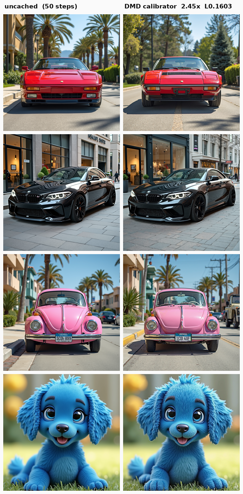
</div>


<div align="center">
  <p align="center">
  <b>DMD vs TaylorSeer Calibrator</b>, FLUX.1-dev, ~3.2x cache acceleration
  </p>
  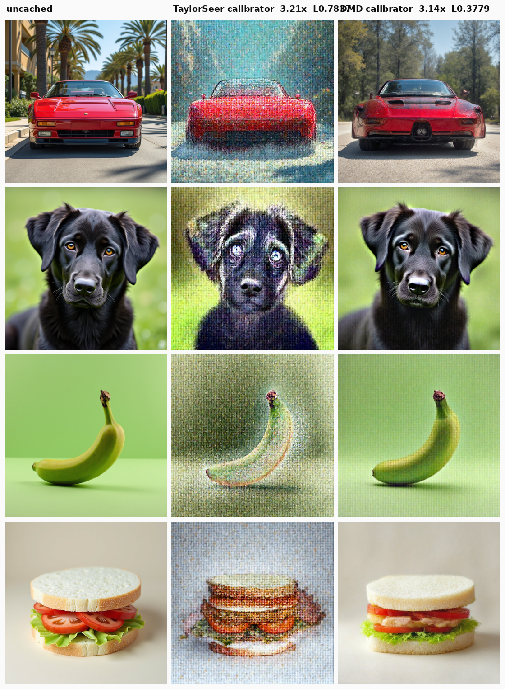
</div>


Quantitative comparison on 12 DrawBench prompts (LPIPS/PSNR vs own uncached image, CLIP = prompt alignment):

<div align="center" markdown="1">

| Calibrator | LPIPS ↓ | PSNR (dB) ↑ | CLIP ↑ |
|:---|:---:|:---:|:---:|
| TaylorSeer | 0.78 | 11.8 | 0.27 |
| **DMD** | **0.38** | **19.8** | **0.32** |

</div>

**Important**: The `dmd_history` parameter controls how many recent compute-step snapshots are retained. A longer history does not always help — the feature dynamics drift across timesteps (the propagator is non-autonomous), so a window of 5–6 is typically the sweet spot. Below 4 uniformly spaced snapshots, DMD automatically falls back to TaylorSeer.

<details markdown="1">
<summary>📖 DMD Config Parameters</summary>

| Parameter | Type | Default | Description |
|:---|:---|:---|:---|
| `dmd_history` | `int` | 6 | Snapshot window length per stream. ≥ 4 uniformly spaced snapshots needed before exponential fit engages. |
| `dmd_rank` | `int` | 0 | SVD truncation rank. 0 = automatic (drop modes below 1e-4 of leading singular value). |
| `dmd_ridge` | `float` | 1e-8 | Tikhonov regularisation term added to inverted singular values. |
| `enable_calibrator` | `bool` | True | Whether to enable the calibrator for hidden states. |
| `enable_encoder_calibrator` | `bool` | True | Whether to enable the calibrator for encoder hidden states. |

</details>

## FoCa Calibrator: Forecast then Calibrate

<div id="foca"></div>

**<span style="color:#c77dff;">FoCa (Forecast then Calibrate)</span>** is an **ODE-based** forecasting calibrator, serving as a drop-in alternative to TaylorSeer's polynomial basis and DMD's exponential basis. FoCa treats feature caching as an ODE integration problem — it pairs a BDF2 predictor with a Heun corrector to achieve stable long-skip prediction without training. [arXiv:2508.16211](https://arxiv.org/abs/2508.16211)

### Mathematical Principle

FoCa models the hidden feature evolution across denoising steps as a near-linear ODE:

$$\frac{d}{dt}\mathcal{F}(x_t^l) = g_\theta(\mathcal{F}(x_t^l), t)$$

While $g_\theta$ is not directly solvable, classical linear multi-step integration methods — which only depend on cached historical values — can integrate this ODE stably. FoCa's prediction at the current step is computed via the **Heun trapezoidal rule** anchored to the most recent full-compute step:

$$F_{pred} = F_{full} + \frac{\text{elapsed}}{2} \cdot \big( \text{deriv}_{full} + \text{deriv}_{curr} \big)$$

where:
- $F_{full}$ is the feature tensor at the most recent full-compute step
- $\text{elapsed}$ is the number of steps since that full-compute anchor
- $\text{deriv}_{full} = F_{full} - F_{full\_prev}$ is the reliable derivative at the anchor
- $\text{deriv}_{curr} = F_k - F_{km1}$ is the local derivative from the two most recent values

The Heun trapezoidal rule takes the **average** of the anchor derivative and the local derivative. When the feature evolution is near-linear, the average equals either derivative and FoCa matches linear extrapolation. When the local derivative deviates (cache drift), the anchor derivative pulls the prediction back toward the reliable trend — suppressing overshoot that would otherwise accumulate in recursive prediction. For example:

```python
import cache_dit
from cache_dit import DBCacheConfig, FoCaCalibratorConfig

# DBCache + FoCa Calibrator (zero-config)
cache_dit.enable_cache(
  pipe,
  cache_config=DBCacheConfig(
    max_warmup_steps=8,
    max_cached_steps=-1,
    Fn_compute_blocks=1,
    Bn_compute_blocks=0,  # Bn=0 since FoCa replaces Bn calibrator
    residual_diff_threshold=0.12,
  ),
  calibrator_config=FoCaCalibratorConfig(),
)
```
<details markdown="1">
<summary>📖 FoCa Config Parameters</summary>

| Parameter | Type | Default | Description |
|:---|:---|:---|:---|
| `enable_calibrator` | `bool` | True | Whether to enable the calibrator for hidden states. |
| `enable_encoder_calibrator` | `bool` | False | Whether to enable the calibrator for encoder hidden states. |
| `calibrator_cache_type` | `str` | `"residual"` | Cache type: `"residual"` or `"hidden_states"`. |

FoCA has no algorithm-specific hyper-parameters — the prediction formula adapts automatically to the step intervals.

</details>

## SVD-Cache Calibrator: Token × Channel Low-Rank Split

<div id="svd-cache"></div>

**<span style="color:#c77dff;">SVD-Cache</span>** is a **subspace-split** calibrator: instead of extrapolating the whole cached tensor, it decomposes it in the **token × channel plane** into a low-rank principal part and a high-frequency residual, smooths the principal part across steps, and freezes the residual. It needs no training and — unlike most subspace caching methods — **no offline calibration file**: the basis is estimated at run time from the first full-compute feature of the current inference. [arXiv:2601.07396](https://arxiv.org/abs/2601.07396)

> **Naming note**: SVD-Cache is a **caching** calibrator. It is unrelated to **SVDQuant** (`--quantize-type svdq_*`), which is a weight-quantization backend. On the command line SVD-Cache is spelled `--calibrator svd` (or `--calibrator svd-calibrator`).

> ⚠️ **Measured status (FLUX.1-dev, 1024², 28 steps, seed 0, RTX PRO 5000, 2 prompts, torch 2.15.0, 2026-11-17)**: on this harness **neither predictor beats the plain-reuse baseline often enough to recommend it**, so treat SVD-Cache as reproduction/experimental support:
>
> | Configuration (rdt 0.12, 14/28 cached, ~1.9x) | latency | PSNR (dB) | SSIM |
> |---|---|---|---|
> | DBCache (plain reuse) | 8.85s | 23.11 | 0.8848 |
> | + TaylorSeer | 8.86s | **24.21** | **0.9123** |
> | + DMD | 8.91s | 23.49 | 0.9074 |
> | + SVD-Cache `predictor=ema` (β 0.9) | 9.48s | 20.62 | 0.8051 |
> | + SVD-Cache `predictor=taylor` (order 1) | 9.47s | 23.38 | 0.8882 |
> | + SVD-Cache `predictor=taylor` (order 1, τ 0.999 ⇒ k≈1100) | 9.51s | 23.81 | 0.8990 |
>
> | Configuration (rdt 0.6 + mcc 6, 23/28 cached, ~4.9x) | latency | PSNR (dB) | SSIM |
> |---|---|---|---|
> | DBCache (plain reuse) | 3.48s | 15.95 | 0.6023 |
> | + TaylorSeer | 3.48s | 15.63 | **0.6081** |
> | + SVD-Cache `ema` β 0.9 / β 0.5 | 4.13s | 15.04 / 15.89 | 0.5446 / 0.6006 |
> | + SVD-Cache `taylor` order 1 / order 2 | 4.12s | 15.56 / 15.71 | 0.5881 / 0.5832 |
>
> Reading it: (a) the **EMA** path is a convex blend of two real anchors, so it can only relax reuse — it never extrapolates, and `svd_beta → 0` reproduces plain reuse exactly (measured 15.89 vs 15.95 dB); (b) the **Taylor** path does extrapolate and recovers most of that loss (+2.8 dB at 1.9x), but still trails the plain `TaylorSeer` calibrator while costing ~0.6 s more per image; (c) the loss is **caused by freezing the residual**, not by the predictor: raising τ from 0.9 (k=5, residual ≈10% energy) to 0.999 (k≈1100) recovers +0.43 dB, and the same feature is what the plain `TaylorSeer` calibrator extrapolates instead of freezing. The measured rank at τ=0.9 is tiny (4–5/3072 for hidden states, 2/512 for encoder), matching the paper's claim. **For production use `--calibrator taylorseer` (or `dmd`).**

### Mathematical Principle

For a cached block tensor $Y \in \mathbb{R}^{N \times D}$ and a basis $V_C \in \mathbb{R}^{D \times k}$, $\sigma_C \in \mathbb{R}^{k}$ fitted on an earlier full-compute feature:

$$P(Y) = \underbrace{\left(\frac{Y V_C}{\sigma_C}\right)}_{U} \sigma_C V_C^\top, \qquad R = Y - P(Y)$$

$P(Y)$ is the part of the feature that lives in the retained principal subspace (the global structure), $R$ is everything else (the high-frequency tail). The forecast for a cached step is

$$\hat{F} = \mathcal{P}\!\left(P(Y)\right) + R$$

where $\mathcal{P}$ is the configured **predictor**:

- **`predictor="ema"`** (default) — the paper's per-step smoothing, $\mathcal{P} = \mathrm{EMA}_\beta$. Every full-compute step blends the new principal part in ($\hat{P} \leftarrow \beta \hat{P} + (1-\beta) P(Y)$) and every cached step advances the same blend one more tick towards the anchor, so the principal stream **lags**. It is bounded by construction ($\beta^j \to 0$, $\hat{F} \to Y_{anchor}$) and `svd_beta=0` reproduces plain reuse — but by the same token it can only interpolate between two real anchors, never extrapolate.
- **`predictor="taylor"`** — the paper's SVD + Taylor combination (Fig. 5(b)). A divided-difference Taylor ladder is kept on the **low-rank coefficients** $c = Y V_C$ (shape $[M, k]$, $k \approx 4$ here) and extrapolated by the elapsed step count, then projected back: $\mathcal{P}(P) = \left(\sum_i \frac{1}{i!} \Delta^i c \cdot e^i\right) V_C^\top$. The truncation acts as a low-pass filter on the derivative estimate, and the extra cost is one $[M,k] \times [k,D]$ GEMM per cached step.

- **Basis**: fitted once per stream per inference, with the rank chosen by retained energy — the smallest $k$ with $\sum_{i \leq k} \sigma_i^2 \geq \tau \sum_i \sigma_i^2$ ($\tau$ = `svd_tau`, default 0.9), then optionally capped by `svd_max_rank`. The rank actually used is logged (`SVD-Cache basis fitted: rank=k/…`). The basis is **frozen for the whole inference**: the Taylor ladder lives in it, so refitting would invalidate every stored coefficient.
- **Residual**: frozen from the last full-compute step. This is the assumption the measurements above contradict — the high-frequency tail moves *fastest* between steps, so freezing it is where the quality is lost.

The calibrator only replaces the `Bn_residual` operand of DBCache's fusion ($H(F_n)_t + R_{B_n}$); the threshold logic, the counters, and the skip granularity are untouched, exactly like TaylorSeer/DMD/FoCa.

```python
import cache_dit
from cache_dit import DBCacheConfig, SVDCalibratorConfig

# DBCache + SVD-Cache calibrator (the basis is fitted on the fly)
cache_dit.enable_cache(
  pipe,
  cache_config=DBCacheConfig(
    max_warmup_steps=8,
    max_cached_steps=-1,
    Fn_compute_blocks=1,
    Bn_compute_blocks=0,  # Bn=0 since SVD-Cache replaces Bn calibrator
    residual_diff_threshold=0.12,
  ),
  calibrator_config=SVDCalibratorConfig(
    svd_tau=0.9,          # energy retained by the principal subspace
    svd_predictor="ema",  # "ema" (paper smoothing) or "taylor" (SVD + Taylor)
    svd_beta=0.9,         # EMA coefficient, only used by predictor="ema"
    svd_order=1,          # Taylor orders, only used by predictor="taylor"
    svd_max_rank=0,       # 0 = energy-based rank, uncapped
  ),
)
```

Or from the command line:

```bash
python3 -m cache_dit.generate flux --cache --calibrator svd \
        --calibrator-params "tau=0.9,beta=0.9" --save-path flux.cache.svd.png
python3 -m cache_dit.generate flux --cache --calibrator svd \
        --calibrator-params "predictor=taylor,order=1,tau=0.9" --save-path flux.cache.svd.taylor.png
```

<details markdown="1">
<summary>📖 SVD-Cache Config Parameters</summary>

| Parameter | Type | Default | Description |
|:---|:---|:---|:---|
| `svd_tau` | `float` | 0.9 | Cumulative squared-singular-value energy retained by the principal subspace, in (0, 1]. Smaller keeps a smaller subspace. |
| `svd_predictor` | `str` | `"ema"` | How the principal part is forecast: `"ema"` (paper smoothing) or `"taylor"` (SVD + Taylor, paper Fig. 5(b)). |
| `svd_beta` | `float` | 0.9 | EMA coefficient of the principal stream in [0, 1); only used by `predictor="ema"`. 0 reproduces plain reuse. |
| `svd_order` | `int` | 1 | Taylor orders kept by `predictor="taylor"`; ignored by `"ema"`. |
| `svd_max_rank` | `int` | 0 | Hard cap on the retained rank; 0 keeps the energy-based choice. |
| `enable_calibrator` | `bool` | True | Whether to enable the calibrator for hidden states. |
| `enable_encoder_calibrator` | `bool` | True | Whether to enable the calibrator for encoder hidden states. |
| `calibrator_cache_type` | `str` | `"residual"` | Cache type: `"residual"` or `"hidden_states"`. |

The basis is fitted once per stream, so the cost is dominated by a single economy SVD (`O(N·D²)`) plus 2 thin GEMMs per full-compute step; the extra memory is roughly 3× one block group plus the `D × k` basis.

</details>

## TaylorSeer vs HiCache vs BRACE vs BeziCast vs DMD vs FoCa vs SVD-Cache: When to Use Which

<div align="center" markdown="1">

| Aspect | TaylorSeer (Polynomial) | HiCache (Damped Hermite) | BRACE (Barycentric rational) | BeziCast (Bernstein/Bezier) | DMD (Exponential) | FoCa (ODE Heun) | SVD-Cache (Low-rank split) |
|:---|:---|:---|:---|:---|:---|:---|:---|
| **Basis** | Polynomial: $\sum \frac{d^nY}{dt^n} \frac{t^n}{n!}$ | Damped Hermite: $\sum \frac{\Delta^nY}{n!}\sigma^n H_n(\sigma t)$ | Adapted Chebyshev-weighted rational aggregation | Tikhonov-stabilized Bernstein equivalent weights | Exponential: $\Phi \cdot (\lambda^k \odot b)$ | ODE Heun trapezoidal rule | Principal subspace $V_C,\sigma_C$ over the token × channel plane |
| **Anchor** | Most recent full-compute step | Most recent full-compute step | FIFO of ≤3 real full-compute steps | FIFO of ≤6 real full-compute steps | Sliding snapshot window (≥4) | Most recent full-compute step | Most recent full-compute step |
| **Extrapolation** | Diverges as $t^n \to \infty$ | Bounded: order $n$ damped by $\sigma^{2n}$ | Rational; supports non-uniform logical-step anchors | Clipped query with optional simplex guardrail | Bounded when $\lvert\lambda\rvert \leq 1$ | Moderate: Heun averaging suppresses overshoot | Bounded: converges back to plain reuse |
| **Per-step cost** | O(1) | O(1) — same ladder as TaylorSeer | O(C) tensor multiply-adds | Small CPU fit + O(K) tensor multiply-adds | O(1) per skip (cached SVD+eig per window) | O(1) — 4 tensor ops | 2 thin GEMMs per compute step, one add per skip |
| **Hyper-parameters** | `taylorseer_order` (default 1) | `hicache_order` (default 2, ≤4), `hicache_sigma` (default 0.5) | `brace_capacity` (default 3), `brace_gamma` (default 0.7) | `bezicast_history`, `bezicast_control_points`, `bezicast_ridge`, optional guardrail | `dmd_history`, `dmd_rank`, `dmd_ridge`, `dmd_svd_precision` | **None** — auto-adaptive | `svd_tau`, `svd_beta`, `svd_max_rank` |
| **Best for** | DiT DDPM | Aggressive caching with long skip intervals; re-sweep `sigma` per model and threshold | Experimental derivative-free forecasting; validate per model | Experimental non-uniform fitting and over-weight control | Flow-matching | General-purpose; simpler than DMD | Reproduction only — `ema` sits below plain reuse, `taylor` recovers it but trails TaylorSeer (see the measured note above) |
| **Memory** | 2× tensors (derivative ladder) | 2× tensors (shared with TaylorSeer) | C× tensors (real-anchor FIFO) | K× tensors (real-anchor FIFO) | `history` × tensors (snapshot window) | 4× tensors (F_k, F_km1, F_full, F_full_prev) | 3× tensors + `D×k` basis |

</div>

Here is an example of the comparison among DBCache only, DBCache + TaylorSeer, DBCache + FoCa, and DBCache + DMD. In this case, DMD shows better performance than TaylorSeer and FoCa in terms of both image quality and prompt alignment. However, the best choice of calibrator may vary across models and use cases, so we recommend users to try out different calibrators to find the best fit for their specific scenario. (NVIDIA L20, FLUX.1-dev, 28 steps, residual_diff_threshold=0.5, max_continuous_cached_steps=6)

<div align="center" markdown="1">

|Baseline| DBCache Only | + TaylorSeer | + FoCa | + DMD |
|:--:|:--:|:--:|:--:|:--:|
|28 steps| cached 17 steps| cached 17 steps| cached 17 steps| cached 17 steps|
||||||

</div>

## SCM: Steps Computation Masking

<div id="steps-mask"></div>


The <span style="color:#c77dff;">steps_computation_mask</span> parameter adopts a step-wise computation masking approach inspired by [LeMiCa](https://github.com/UnicomAI/LeMiCa) and [EasyCache](https://github.com/H-EmbodVis/EasyCache). Its key insight is that **early caching induces amplified downstream errors, whereas later caching is less disruptive**, resulting in a **non-uniform** distribution of cached steps. 

|LeMiCa: Non-Uniform Cache Steps|LeMiCa: Cache Errors|EasyCache: Transformation rate Analysis|
|:---:|:---:|:---:|
|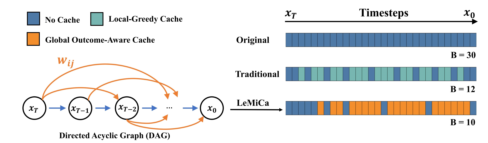|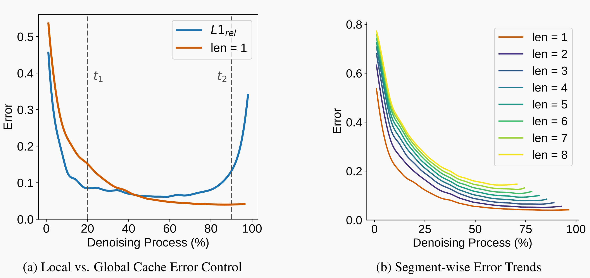|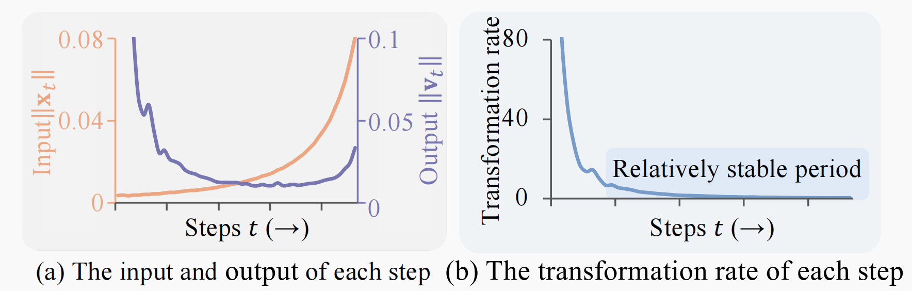|

It is a list of length num_inference_steps indicating whether to compute each step or not. <span style="color:#c77dff;">1 means must compute, 0 means use dynamic or static cache</span>. If provided, will override other settings to decide whether to compute each step. Please check the [📚examples/steps_mask](https://github.com/vipshop/cache-dit/blob/main/examples/api/run_steps_mask.py) for more details.


```python
from cache_dit import DBCacheConfig, TaylorSeerCalibratorConfig

# Scheme: Hybrid DBCache + SCM + TaylorSeer
cache_dit.enable_cache(
  pipe_or_adapter,
  cache_config=DBCacheConfig(
    # Basic DBCache configs
    Fn_compute_blocks=8,
    Bn_compute_blocks=0,
    # NOTE: warmup steps is not required now!
    residual_diff_threshold=0.12,
    # LeMiCa or EasyCache style Mask for 28 steps, e.g, 
    # SCM=111111010010000010000100001, 1: compute, 0: cache.
    steps_computation_mask=cache_dit.steps_mask(
      # e.g: slow, medium, fast, ultra.
      mask_policy="fast", total_steps=28,
      # Or, you can use bins setting to get custom mask.
      # compute_bins=[6, 1, 1, 1, 1], # 10
      # cache_bins=[1, 2, 5, 5, 5], # 18
    ),
    # The policy for cache steps can be 'dynamic' or 'static'
    steps_computation_policy="dynamic",
  ),
  calibrator_config=TaylorSeerCalibratorConfig(
    taylorseer_order=1,
  ),
)

```

As we can observe, in the case of **static cache**, the image of `SCM Slow S*` (please click to enlarge) has shown **obvious blurriness**. However, the **Ultra** version under **dynamic cache** (`SCM Ultra D*`) still maintains excellent clarity. Therefore, we prioritize recommending the use of dynamic cache while using `SCM: steps_computation_mask`.


|Baseline|SCM S S*|SCM S D*|SCM F D*|<span style="color:#c77dff;">SCM U D*</span>|+TS|+compile|+FP8 +Sage|  
|:---:|:---:|:---:|:---:|:---:|:---:|:---:|:---:|
|24.85s|15.4s|17.1s|11.4s|8.2s|8.2s|7.1s|4.5s|
|||||||||

<p align="center">
  Scheme: <b><span style="color:#c77dff;">DBCache + SCM(steps_computation_mask) + TaylorSeer</span></b>, L20x1, S*: static cache, <b>D*: dynamic cache</b>, <br><b>S</b>: Slow, <b>F</b>: Fast, <b>U</b>: Ultra Fast, <b>TS</b>: TaylorSeer, FP8: FP8 DQ, Sage: SageAttention, <b>FLUX.1-Dev</b>, <br>Steps: 28, HxW=1024x1024, Prompt: "A cat holding a sign that says hello world"
</p>

|DBCache + SCM Slow S*|DBCache + SCM Ultra D* + TaylorSeer + compile| 
|:---:|:---:|
|15.4s|7.1s|
|||

<p align="center">
<b>Dynamic Caching is all you need!</b> The <b>Ultra</b> fast version under dynamic cache (<b>SCM Ultra D*</b>) <br>maintains <b>better clarity</b> than the slower static cache one (<b>SCM Slow S*</b>).
</p>

## MCC: Multiple Cache Contexts within a single Denoising Loop

Users can use <span style="color:#c77dff;">force_refresh_step_hint</span> param to provide a step index hint (integer number) to force refresh the cache. If provided, the cache will be refreshed at the beginning of this step. This is useful for some cases where the input condition changes significantly at a certain step. Default None means no force refresh. For example, in a 100-step inference, setting force_refresh_step_hint=25 will refresh the cache before executing step 25 and view the remaining 75 steps as a new inference context.

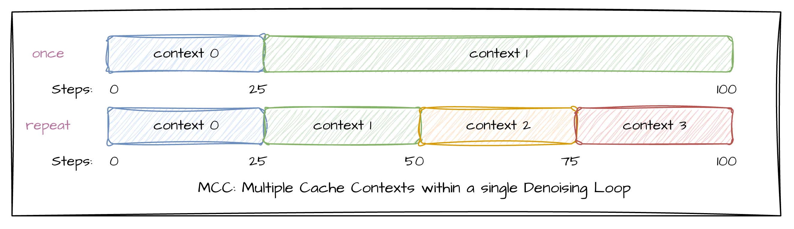

The <span style="color:#c77dff;">force_refresh_step_policy</span> is a helper parameter for <span style="color:#c77dff;">force_refresh_step_hint</span> and can be set to "repeat" or "once". <span style="color:#c77dff;">repeat</span> means we will refresh the cache at each time the step index hint occurs, while <span style="color:#c77dff;">once</span> means we will only refresh the cache at the first occurrence of the step index hint. This is useful for some cases where the input condition changes significantly at a certain step in each inference loop.  e.g., if force_refresh_step_hint=25 and the inference has 100 steps, then the cache will be refreshed at:  

- <span style="color:#c77dff;">once</span> policy: step 25, treat the remaining steps as a new inference context, no more refresh after step 25;  
- <span style="color:#c77dff;">repeat</span> policy: step 25, 50, 75, treat the steps between each refresh as a new inference context.  

These usages are useful for cases like **GLM-Image** and **Helios-14B** Video Generation models, where the input condition changes significantly at the middle step of the denoising process. For example:

```python
# Helios-14B
cache_dit.enable_cache(
  pipe_or_adapter,
  # Cache config with force refresh hint and policy for Helios-14B.
  cache_config=DBCacheConfig(
    ...,
    # Update cache context per num_inference_steps (e.g, 50) since Helios-14B
    # will split the num_frames into multiple chunks and do multiple passes 
    # of transformer denoise loop, and the cache context should be refreshed 
    # at the end of each loop to ensure the previous cache will never be used
    # in the next loop.
    force_refresh_step_hint=50,
    force_refresh_step_policy="repeat",
  ),
)

# GLM-Image
cache_dit.enable_cache(
  pipe_or_adapter,
  # Cache config with force refresh hint and policy for GLM-Image.
  cache_config=DBCacheConfig(
    ...,
    # Since 'image' parameter is used in input_data, we have set the value of
    # force_refresh_step_hint to the number of prompts x number of images
    # which is 1 x 1 = 1 here. GLM-Image will do processing for the prompt
    # and image at each pipeline inference by calling the transformer, so,
    # we need to force refresh the cached hidden states at after the
    # preprocessing done.
    force_refresh_step_hint=1,
    force_refresh_step_policy="once",
  ),
)
```
