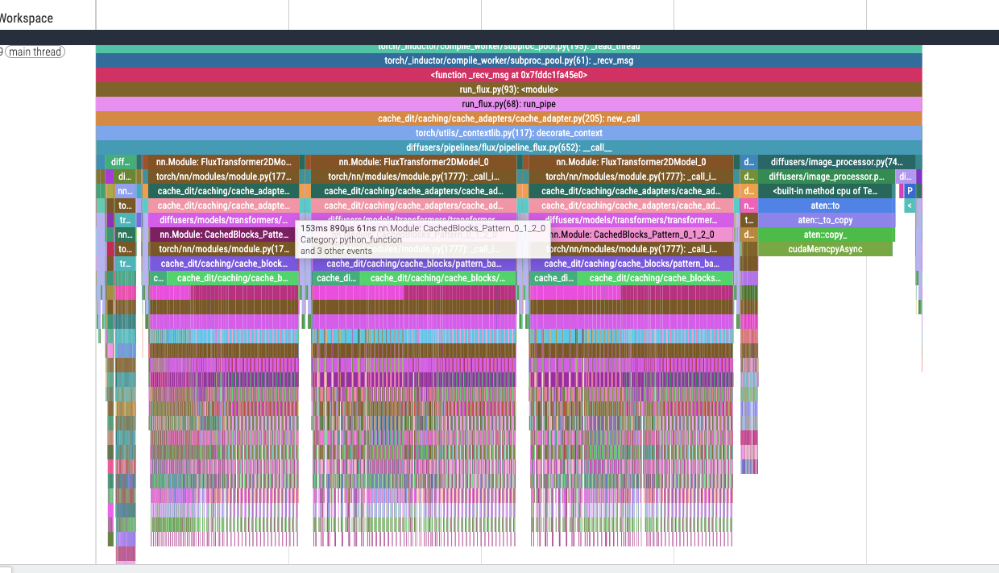
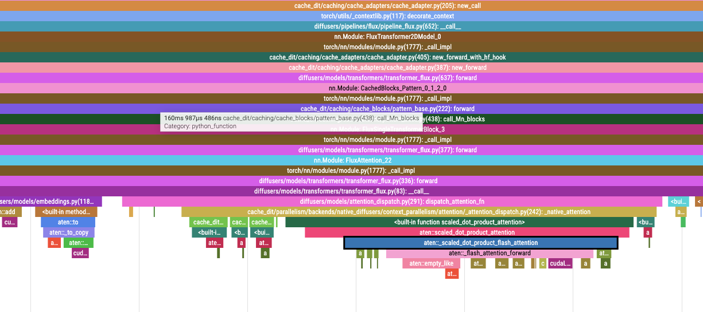
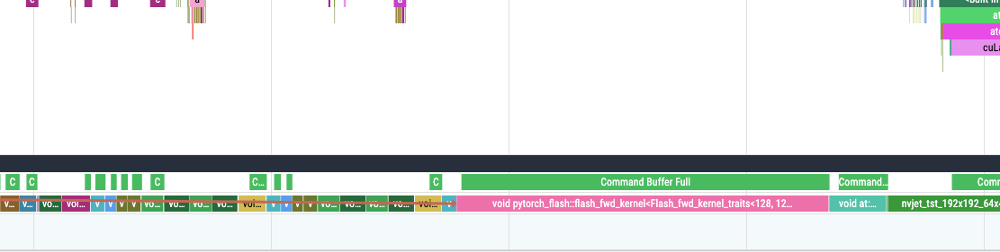

# Profiler Usage

Cache-DiT uses Torch Profiler to collect requests or selected complete denoising steps.

## Quick Start

Make sure `cache_dit` is importable, then run from the `examples/` directory:

```bash
cd examples
python3 generate.py list

# A short inference produces a small Torch trace.
python3 generate.py flux --profile --steps 3 --warmup 1 --repeat 1

# Choose the Torch output directory and filename prefix.
python3 generate.py flux --profile --steps 3 --warmup 1 --repeat 1 \
    --profile-dir /tmp/cache_dit_profiles --profile-name flux_test
```

The CLI preserves the original order: load, optimize, warm up, then run the formal requests.
Each iteration of `--repeat` gets its own profiler context; initialization and warmup are outside
these windows. The default `--profile-ranges all` captures each complete formal request.

Reducing `--steps` is convenient for a quick trace. To inspect caching or compiled execution at
the original step count, keep the full inference and select a smaller window as shown in the
[MiniMax-H3 example](#advanced-example-minimax-h3-with-cache-and-compile).

## Request and Step Windows

Use `--profile-ranges`:

| Value | Collection boundary |
|---|---|
| `all` (default) | Entering and leaving the formal request, including encoding, denoising and decoding |
| `0-2` | Before step 0 through the end of step 2: three complete logical steps |
| `0,2` | Two separate one-step windows |
| `0-2,8-10` | Two separate three-step windows; the intervening steps still run normally |

### Select Denoising Steps

Indices start at zero in each actual denoising loop and endpoints are inclusive. Use nonnegative
integers; a single index such as `3` selects one step. Overlapping or adjacent ranges merge, so
`0-2,2-4` and `0-2,3-4` each produce one `0-4` window.

A step includes its input preparation, prediction, CFG where applicable, scheduler updates,
callbacks, progress and other work in the original loop body. Forward calls, scheduler call counts
and timestep values do not define the step index. Numeric windows exclude work before and after
the loop, such as conditioning and decoding. The rest of the inference still completes.

The ranges apply independently to every integrated loop. For example, two 20-step loops with
`0-4,10-14` produce four windows per request. Each continuous window starts and stops collection
separately. All declared devices are synchronized at its boundaries.

The `minimax_h3`, `minimax_h3_fl2va` and `minimax_h3_ref2va` examples already provide complete step
boundaries, including video and audio scheduler updates and progress. MiniMax-H3 uses the requested
number of sigma grid points and performs one fewer logical step: `--steps 50` produces steps 0–48.

Other pipelines need explicit [`profile_steps()` integration](#python-requests-and-loop-boundaries)
for numeric ranges; whole-request `all` collection remains available. A normally completed numeric
request that never enters `profile_steps()` raises `RuntimeError`. An empty loop or unmatched range
produces no window or trace; check `results` and `empty_reason`.

## Torch Profiler

Use `--profile-activities` to select host events,
accelerator events and optional memory recording:

```bash
cd examples
python3 generate.py flux --profile --steps 3 --warmup 1 --repeat 1 \
    --profile-activities CPU GPU MEM
```

`GPU` maps to CUDA or Ascend NPU on the current platform. `MEM` alone also selects the current
accelerator activity; add `CPU` to include host operators. Memory recording on CUDA writes a
snapshot and a text memory summary in addition to the trace.

### Output Files

Each window has a unique name containing the profile prefix, host, PID, rank, request ID, loop
and window. For example:

```text
flux_test-<host>-pid<PID>-rank0-<request_id>-loopall-window0.trace.json.gz
h3-<host>-pid<PID>-rank0-<request_id>-loop0-window0.trace.json.gz
h3-<host>-pid<PID>-rank0-<request_id>-loop0-window0-memory.pickle
h3-<host>-pid<PID>-rank0-<request_id>-loop0-window0-memory.txt
```

CUDA exports compressed Chrome traces. Ascend exports each window's full CANN directory,
including `ASCEND_PROFILER_OUTPUT` and raw profiler data. `CACHE_DIT_NPU_PROFILER_LEVEL` selects
`Level0` (default), `Level1`, `Level2` or `none`.

The default output directory is `CACHE_DIT_TORCH_PROFILER_DIR`, or `/tmp/cache_dit_profiles`.
`get_profiler_output_dir()` reads it; `set_profiler_output_dir(path)` changes the default for
subsequent contexts. An explicit `output_dir` or `--profile-dir` takes priority.

### Python Stacks and Trace Size

Shorter inferences, fewer repeats and smaller numeric windows reduce trace size. Python stack
recording is enabled by default for the CLI and `ProfilerContext`; disable it when an operator
and kernel timeline is sufficient:

```bash
cd examples
python3 generate.py flux --profile --steps 3 --no-profile-with-stack
```

In the tested Python 3.12.13 / PyTorch 2.11.0+cu130 collective workload, stack recording also
produced invalid Python/C-call ranges that extended beyond their parents and appeared deeply
nested. If this occurs, collect again with `--no-profile-with-stack` or `with_stack=False`.
CPU operators and accelerator events remain available, while the Python call tree is omitted.
Changing viewers does not repair invalid ranges already stored in a trace.

## Advanced Example: MiniMax-H3 with Cache and Compile

Keep the full step count and warm up the same computation and cache paths before collecting.
This two-GPU t2va example uses TP2, text encoder parallelism, default DBCache, regional compile
and native attention. Replace the model path with your MiniMax-H3 checkpoint:

```bash
CUDA_VISIBLE_DEVICES=0,1 python3 -m torch.distributed.run --standalone --nproc_per_node=2 \
    -m cache_dit.generate minimax_h3 --model-path /path/to/MiniMax-H3 \
    --parallel tp --parallel-text --cache --compile --attn native --vae-tiling \
    --steps 50 --height 448 --width 768 --num-frames 124 --seed 42 \
    --warmup 1 --warmup-num-inference-steps 50 --repeat 1 \
    --profile --profile-ranges 0-2,8-10 --no-profile-with-stack \
    --profile-name h3 --profile-dir /tmp/cache_dit_profiles
```

This completes all 49 logical steps and decoding, exporting two Torch traces per rank. The first
three steps are inside the default cache warmup. In the validated run, steps 8 and 10 were cache
hits and step 9 performed the full computation; cache decisions can vary with inputs and settings.

## Independent NVTX Annotations

NVTX labels and collection windows have separate controls. Both annotation switches default to off
and require CUDA when enabled:

| Switch | Behavior after optimization and the original warmup |
|---|---|
| `--nvtx` | Enable explicit stage annotations without resolving module roots or installing hooks |
| `--layerwise-nvtx` | Enable stages and temporary forward hooks on the final transformer roots |

Neither switch enables `--profile`. An external collector is needed to observe the annotations;
NVTX itself writes no report. `--profile-ranges` controls collection, not NVTX emission. Leaving
both switches off preserves CPU execution and the existing Ascend Torch profiling path.

The CLI installs module hooks once after its original warmup, keeps them across formal repeats,
and removes its own handles on exit. It resolves the pipeline's actual denoising transformers:
`transformer_ref` for MiniMax-H3 ref2va, and applicable secondary transformers for other pipelines.
Text encoders, VAEs and schedulers are not automatically traversed by transformer hooks.

### Python Annotations

Direct callers finish their usual optimization and warmup before declaring the execution roots.
For stages alone, use `nvtx_scope()` and place `stage_range()` at the actual execution boundary:

```python
from cache_dit import LayerwiseNvtxMarker, nvtx_scope, stage_range

# No module traversal or hooks.
with nvtx_scope():
    with stage_range("request"):
        output = pipe(**inputs)

# Example for an already loaded and warmed MiniMax-H3 ref2va pipeline.
with LayerwiseNvtxMarker({"transformer_ref": pipe.transformer_ref}):
    for _ in range(repeat):
        with stage_range("request"):
            output = pipe(**inputs)
```

The marker enables stages as well as module annotations; no profiler request is required.
`stage_range()` is a no-op outside an enabled scope. `nvtx_scope(enabled=False)` temporarily
disables stages and restores the previous setting on exit.

Each module instance uses its first declared path. Labels include its path, type, direct parameter
shapes and tensor input shapes, including keyword arguments. The marker preserves existing hooks,
inputs and outputs, and removes its handles on normal exit, forward failure or partial installation
failure. Stage and marker-exit cleanup preserve an existing model exception; module post-hooks
follow PyTorch's `always_call` exception rules.

### Visibility with Compile and CUDA Graph

For modules compiled with `nn.Module.compile()`, including Diffusers `compile_repeated_blocks()`,
the marker annotates the compiled module's outer call and leaves its descendants unmodified.
Both NVTX hooks run outside Dynamo tracing. This preserves the validated regional-compile/TP
execution while retaining compiled block names; it does not expose every operation inside a graph.
Other `torch.compile(module)` wrapping forms need separate validation.

Cache skips, direct `forward()` calls and CUDA Graph replay can reduce visible module names.
Missing names do not establish that computation was absent. The marker keeps the original
compilation and graph settings and adds no warmup or eager fallback. Warmup with different shapes,
too few steps or no warmup can still leave compilation in the formal request.

One range-accuracy limitation remains: if the same module recursively calls itself, an inner
global pre-hook fails before the marker's local pre-hook, and the outer forward catches it and
continues, the inner always-call post-hook can end the outer module range early. Ordinary recursion
and local pre-hook failures are covered. Removing handles alone also does not prove that every
compiled executable stopped retaining annotations; validate other compile/graph combinations
before interpreting them.

## Python Requests and Loop Boundaries

`ProfilerContext` wraps one inference. It defaults to `enabled=True`,
`ranges="all"`, `with_stack=True` and `record_shapes=True`:

```python
from cache_dit import ProfilerContext

# After the original initialization, optimization and warmup.
with ProfilerContext(ranges="all", devices=["cuda:0"],
                     output_dir="/tmp/cache_dit_profiles") as request:
    output = pipe(**inputs)

for result in request.results:
    print(result.loop_id, result.requested_range, result.actual_range,
          result.status, result.trace_path)
```

`create_profiler_context()` forwards context options and defaults to `enabled=False`.
`profile_function()` accepts keyword-only `ranges` and `devices` and defaults to
`with_stack=False`.

Disabled contexts perform no collection and work on CPU. Enabled Torch requests require CUDA or
Ascend NPU. Only one Cache-DiT profiler request can be active in a process,
including the gaps between numeric windows.

### Add Complete-Step Boundaries

Integrate `profile_steps()` in the pipeline's actual loop before selecting numeric ranges:

```python
from cache_dit import profile_steps

with profile_steps(timesteps) as steps:
    for i, t in steps:
        ...  # Original input preparation, prediction, CFG and scheduler updates.
        ...  # Original callbacks, progress and all remaining work for this step.
```

Keep the context around the loop so `break`, `return` and exceptions close its numeric window
before later work. Without an active numeric request, it behaves as ordinary `enumerate()`;
`all` stays open until the request exits. Wrap the inference with
`ProfilerContext(ranges="0-2,8-10", devices=...)` to select those complete steps.

For direct MiniMax-H3 use, construct the pipeline with the Cache-DiT blocks factory before loading
components. Define `model_path` and your usual `component_dtypes`, then retain the original
placement, optimization and warmup:

```python
from diffusers import MiniMaxH3ModularPipeline
from cache_dit.models.pipelines.minimax_h3 import minimax_h3_blocks

pipe = MiniMaxH3ModularPipeline(
    blocks=minimax_h3_blocks(), pretrained_model_name_or_path=model_path
)
pipe.load_components(workflow="t2va", dtype=component_dtypes)
```

### Results and Early Exit

`request.results` contains zero or more window results. Each records request/loop/window IDs,
requested and actual ranges, `last_step_complete`, status and successful artifact paths.
Whole-request `all` results have no step range or last-step flag.

| Status | Meaning |
|---|---|
| `completed` | The selected endpoint finished, or an `all` request returned normally |
| `exhausted` | The loop ended before the selected endpoint |
| `interrupted` | The loop exited early, for example by `break` or `return` |
| `error` | An error occurred while opening, running or closing this window |

An early-exit step whose iterator has not resumed is not marked complete. A start index never
reached creates no window. A range extending past the loop records the steps actually reached.

`request.trace_path` retains the most recent successful Torch trace, or `None`; use `results` for
all windows. CUDA memory snapshots and summaries are recorded independently, so an error window
can still contain usable memory artifacts. Cleanup attempts each device synchronization, stop,
export and memory-history shutdown independently, preserving an existing model exception.

## Parameters

`create_profiler_from_args(args, profile_name=None, devices=None)` maps CLI arguments to a
`ProfilerContext`. The optional name overrides the parsed name; `devices` specifies every device
used by the request.

| CLI argument | Default | Meaning |
|---|---|---|
| `--profile` | Off | Enable Torch collection |
| `--nvtx` | Off | Explicit stage annotations, independent of collection |
| `--layerwise-nvtx` | Off | Stages and transformer module hooks |
| `--profile-ranges` | `all` | Whole request or inclusive logical-step ranges |
| `--profile-name` | `<example>_profile` | Torch filename prefix |
| `--profile-dir` | Environment value or `/tmp/cache_dit_profiles` | Torch output directory |
| `--profile-activities` | `CPU GPU` | Torch activities; add `MEM` for memory recording |
| `--profile-with-stack` / `--no-profile-with-stack` | On | Enable or disable Torch Python stacks |
| `--profile-record-shapes` | On | Record Torch tensor shapes |

The Python API also accepts `CUDA` or `NPU` as an activity name for the current accelerator.
Enabled Torch requests reject unknown activities even when no numeric window matches. Disabled
requests skip this validation. Set `record_shapes=False` through Python to disable shape recording.

## Multi-GPU Torch Profiling

With `torchrun`, each worker creates its own request and Torch artifacts. The CLI synchronizes
its rank's device, or all visible devices for balanced loading. Direct callers must pass every
device used by the request, for example `devices=["cuda:0", "cuda:1"]`; omitting `devices` uses the
current device only. Profiling does not scan the model for devices.

```bash
cd examples
torchrun --standalone --nproc_per_node=2 generate.py flux \
    --parallel tp --profile --profile-name flux_tp --steps 3 --warmup 1 --repeat 1
```

Each rank exports one `loopall-window0` trace for this request, distinguished by its rank, PID and
request ID. Other parallel modes use the same per-process Torch collection. A driver context does
not propagate to remote Ray actors; collection must be integrated in the actual execution actor.

## View Results

### Torch Traces

Open [Perfetto UI](https://ui.perfetto.dev/) and drag in the generated `.trace.json.gz` file. Load
each rank's Torch trace separately. Chrome's `chrome://tracing` can also open these traces.

The screenshots show a FLUX.1-dev Torch trace:







Collection, synchronization, annotation and export add overhead. Use a separate
unprofiled run with the same configuration to measure speed.
