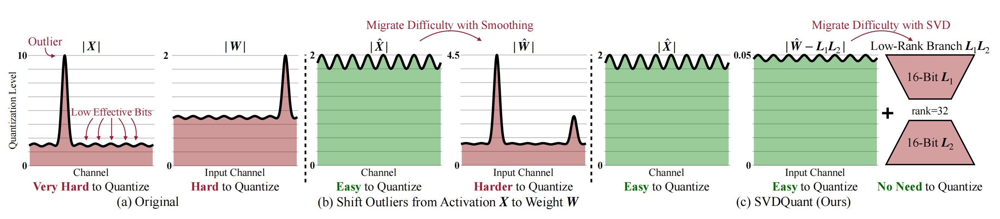
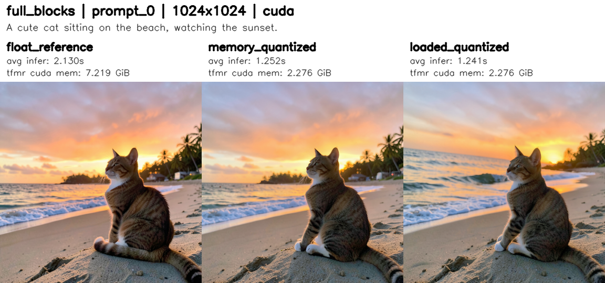
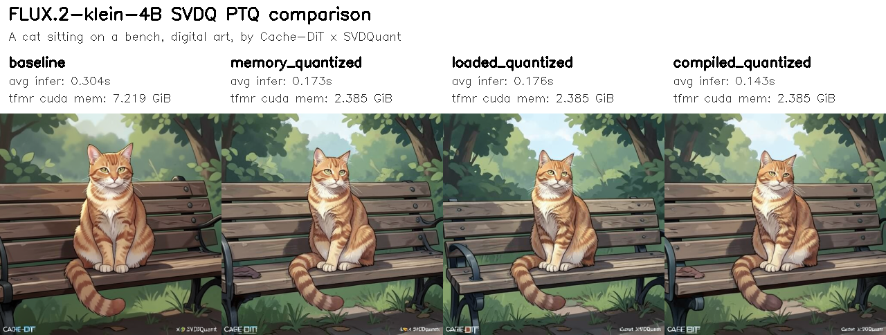
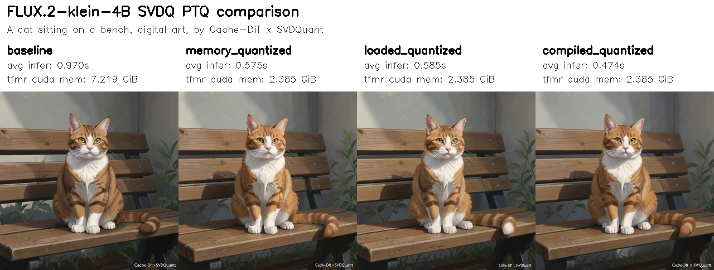

# Low-bits Quantization

<div id="quantization"></div>

## Overview

Quantization is a powerful technique to reduce the memory footprint and computational cost of deep learning models by representing weights and activations with lower precision data types. Cache-DiT supports various quantization methods, including <span style="color:green;">FP8</span>, <span style="color:green;">INT8</span>, <span style="color:green;">INT4</span>, and <span style="color:green;">NVFP4</span> quantization, to help users achieve faster inference and lower memory usage while maintaining acceptable model performance.

|Quantization Types| Description|Devices|
|:---|:---|:---| 
|<span style="color:#c77dff;">float8_per_row</span> |quantize weights and activations to float8 (<span style="color:green;">dynamic quantization</span>) with rowwise method. (**<span style="color:#c77dff;">recommended</span>**)|TorchAO: <span style="color:#c77dff;">>=sm89</span>; cache-dit: <span style="color:#c77dff;">>=sm100</span>|
|<span style="color:#c77dff;">float8_per_tensor</span>|quantize weights and activations to float8 (<span style="color:green;">dynamic quantization</span>) with tensorwise method.|TorchAO: <span style="color:#c77dff;">>=sm89</span>; cache-dit: <span style="color:#c77dff;">>=sm100</span>|
|<span style="color:#c77dff;">float8_per_block</span>|block-wise quantization weights and activations (<span style="color:green;">dynamic quantization</span>) to float8, which can provide better precision, activations's blocksize: (1, 128), weight's blocksize: (128, 128) |TorchAO: <span style="color:#c77dff;">>=sm89</span>; cache-dit: <span style="color:#c77dff;">>=sm100</span>|
|<span style="color:#c77dff;">float8_weight_only</span>|quantize <span style="color:green;">only weights</span> to float8, keep activations in full precision|<span style="color:#c77dff;">>=sm89</span>, Ada, Hopper or newer|
|<span style="color:#c77dff;">int8_per_row</span>|quantize weights and activations to int8 (<span style="color:green;">dynamic quantization</span>) with rowwise method.|<span style="color:#c77dff;">>=sm80</span>, Ampere or newer|
|<span style="color:#c77dff;">int8_per_tensor</span>|quantize weights and activations to int8 (<span style="color:green;">dynamic quantization</span>) with tensorwise method.|<span style="color:#c77dff;">>=sm80</span>, Ampere or newer|
|<span style="color:#c77dff;">int8_weight_only</span>|quantize <span style="color:green;">only weights</span> to int8, keep activations in full precision|<span style="color:#c77dff;">>=sm80</span>, Ampere or newer|
|<span style="color:#c77dff;">int4_weight_only</span>|quantize <span style="color:green;">only weights</span> to int4, keep activations in full precision|<span style="color:#c77dff;">>=sm90</span>, Hopper or newer, TMA required|
|<span style="color:#c77dff;">nvfp4</span>|Dynamic activation and NVFP4 weight quantization. TorchAO uses MSLK Triton quantization plus `torch._scaled_mm`; cache-dit uses its own online quantizer plus an SM120 CUTLASS collective with fused global-scale/bias epilogue by default.|TorchAO: <span style="color:#c77dff;">>=sm100</span>; cache-dit: <span style="color:#c77dff;">>=sm120</span>|
|<span style="color:#c77dff;">nvfp4_weight_only</span>|TorchAO NVFP4 weight-only quantization with dynamic per-tensor weight scaling; activations remain in their original precision.|<span style="color:#c77dff;">>=sm100</span>, Blackwell or newer|
|<span style="color:#c77dff;">svdq_int4_r{32...}</span>|post-training <span style="color:green;">SVDQuant (W4A4)</span> with calibration and checkpoint serialization for users who want the higher-accuracy PTQ workflow.|<span style="color:#c77dff;">>=sm89</span>, Ada or newer, excluded Hopper (NO INT4 MMA; the unified `_C_ops` floor)|
|<span style="color:#c77dff;">svdq_nvfp4_r{32...}</span>|post-training <span style="color:green;">SVDQuant (W4A4)</span> with NVFP4 packed weights/activations, calibration, and checkpoint serialization. Defaults to <span style="color:#c77dff;">runtime_kernel="native"</span>; <span style="color:#c77dff;">cute</span> is an explicit opt-in validation path.|<span style="color:#c77dff;">>=sm120</span>, Blackwell or newer|
|<span style="color:#c77dff;">svdq_int4_r{32...}_dq</span>|quantize weights and activations to int4 with <span style="color:green;">SVDQuant dynamic quantization (W4A4)</span> without any calibration. Defaults to the native W4A4 GEMM.|<span style="color:#c77dff;">>=sm89</span>, Ada or newer, excluded Hopper (NO INT4 MMA; the unified `_C_ops` floor)|
|<span style="color:#c77dff;">svdq_nvfp4_r{32...}_dq</span>|quantize weights and activations to NVFP4 with <span style="color:green;">SVDQuant dynamic quantization (W4A4)</span> without any calibration. Defaults to <span style="color:#c77dff;">runtime_kernel="native"</span>; <span style="color:#c77dff;">cute</span> is an explicit opt-in validation path.|<span style="color:#c77dff;">>=sm120</span>, Blackwell or newer|


## Quantization Backends

The three online FP8 types can run on two independent backends:

- <span style="color:#c77dff;">torchao</span>: the historical path, using TorchAO's Float8Tensor. `per_row` and `per_tensor` use `torch._scaled_mm`; `per_block` uses TorchAO's Triton blockwise GEMM. Requires torchao and works on <span style="color:#c77dff;">>=sm89</span>.
- <span style="color:#c77dff;">cache_dit</span>: Cache-DiT's own E4M3 quantize plus a GEMM selected by `use_native`. It has no torchao runtime dependency, supports the same three granularities, and currently requires <span style="color:#c77dff;">sm100 or newer</span>. CUDA Graph-safe, but TP/DTensor sharding and serialized FP8 checkpoints are not supported. `per_tensor_fallback` is a TorchAO/TP compatibility switch and has no effect on this backend. Under `torch.compile`, activation quantization switches to an equivalent pure-Torch implementation so Inductor can fuse it; eager keeps the custom quantize kernel.

For the cache-dit FP8 backend, `fp8_gemm` now defaults to `use_native=False`:

- `per_row` and `per_tensor` use `torch._scaled_mm` (cuBLAS/CUTLASS), the same GEMM operator as TorchAO.
- `per_block` keeps the cache-dit native kernel because `torch._scaled_mm` cannot express its `(1, 128) × (128, 128)` block scales.
- `use_native=True` forces the CuTe kernel for all three modes. The `use_ws` option only affects that native kernel.

Shapes whose output width is not a multiple of 16 fall back to the native kernel for the default path, because `torch._scaled_mm` requires `N % 16 == 0`.

`QuantizeConfig(backend=...)` defaults to `AUTO`. AUTO keeps the existing routing: `svdq*` uses the cache-dit SVDQuant path and every other type uses TorchAO. Passing `backend="cache_dit"` with `float8_per_row`, `float8_per_tensor`, or `float8_per_block` selects the native FP8 path; unsupported combinations raise instead of silently falling back. The CLI equivalent is `--quantize-backend torchao|cache_dit`.

```python
import cache_dit
from cache_dit import QuantizeConfig

cache_dit.quantize(
  pipe.transformer,
  QuantizeConfig(quant_type="float8_per_row", backend="cache_dit"),
)
```

```bash
python3 -m cache_dit.generate flux --model-path /PATH/TO/FLUX.1-dev \
  --quantize-type float8_per_row --quantize-backend cache_dit --compile
```

The native backend keeps the exact TorchAO granularity semantics: `float8_per_row` means per-token activations and per-output-channel weights (per-col of the mathematical `B`), `float8_per_tensor` uses one scale for the whole tensor, and `float8_per_block` uses activation blocks of `(1, 128)` and weight blocks of `(128, 128)` with a rescale after every 128 K elements. The low-level `fp8_gemm` accepts both `use_native` and `use_ws`: `use_native=False` (default) routes per-row/per-tensor through `torch._scaled_mm` and keeps per-block on the native kernel; `use_native=True` forces the CuTe kernel, where `use_ws` selects the mainloop.

## FP8 Quantization

Cache-DiT supports <span style="color:#c77dff;">online</span> quantization with different quantization types. The default TorchAO backend requires <span style="color:green;">torchao>=0.17.0</span>; the optional cache-dit backend uses the bundled `cache_dit._C_ops` extension. Users can implement model quantization by calling <span style="color:#c77dff;">quantize</span> or pass a <span style="color:#c77dff;">QuantizeConfig</span> to <span style="color:#c77dff;">enable_cache</span> API. Install torchao before using the default backend.

```bash
# stable: torchao (change cu130 to cu129 if using CUDA 12.9)
pip install torchao --index-url https://download.pytorch.org/whl/cu130 --upgrade
# nightly: torchao (change cu130 to cu129 if using CUDA 12.9)
pip install --pre torchao --index-url https://download.pytorch.org/whl/nightly/cu130 --upgrade
```

For GPUs with low memory capacity, we recommend using <span style="color:#c77dff;">float8_per_row</span> or <span style="color:#c77dff;">float8_per_block</span>, as these methods cause almost no loss in precision. We also recommend enabling <span style="color:#c77dff;">torch.compile</span> for better performance with quantization. Supported quantization types including:  

  - <span style="color:#c77dff;">float8_per_row</span>: quantize both weights and activations to float8 (dynamic quantization) with rowwise method.  
  - <span style="color:#c77dff;">float8_per_tensor</span>: quantize both weights and activations to float8 (dynamic quantization) with tensorwise method.  
  - <span style="color:#c77dff;">float8_per_block</span>: block-wise quantization weights and activations (dynamic quantization) to float8, which can provide better precision, activations's blocksize: (1, 128), weight's blocksize: (128, 128). **NOT** supported for distributed inference for now.
  - <span style="color:#c77dff;">float8_weight_only</span>: quantize only weights to float8, keep activations in full precision.  

Here are some examples of how to use quantization with cache-dit. You can directly specify the quantization config in the <span style="color:#c77dff;">enable_cache</span> API.

```python
import cache_dit
from cache_dit import DBCacheConfig, ParallelismConfig, QuantizeConfig

# quant_type: float8_per_row, float8_per_tensor, float8_per_block, float8_weight_only, 
# int8_per_row, int8_per_tensor, int8_weight_only, int4_weight_only, etc.
# Pass a QuantizeConfig to the `enable_cache` API.
cache_dit.enable_cache( 
  pipe, cache_config=DBCacheConfig(), # w/ default
  parallelism_config=ParallelismConfig(ulysses_size=2),
  quantize_config=QuantizeConfig(quant_type="float8_per_row"),
)
```

Users can also specify different quantization configs for different components. For example, quantize the <span style="color:#c77dff;">transformer</span> to <span style="color:#c77dff;">float8_per_row</span> and the <span style="color:#c77dff;">text encoder</span> to <span style="color:#c77dff;">float8_weight_only</span>.

```python
import cache_dit
from cache_dit import DBCacheConfig, ParallelismConfig, QuantizeConfig

cache_dit.enable_cache( 
  pipe, cache_config=DBCacheConfig(), # w/ default
  parallelism_config=ParallelismConfig(ulysses_size=2),
  quantize_config=QuantizeConfig(
    components_to_quantize={
      "transformer": {
        "quant_type": "float8_per_row",
        "exclude_layers": ["embedder", "embed"],
      },
      "text_encoder": {
        "quant_type": "float8_weight_only",
        "exclude_layers": ["lm_head"],
      }
    }
  ),
)
```

Or, directly call the <span style="color:#c77dff;">quantize</span> API for more fine-grained control.

```python
import cache_dit
from cache_dit import QuantizeConfig

cache_dit.quantize(
  pipe.transformer, 
  quantize_config=QuantizeConfig(quant_type="float8_per_row"),
)
cache_dit.quantize(
  pipe.text_encoder, 
  quantize_config=QuantizeConfig(quant_type="float8_weight_only"),
)
```

Please also enable <span style="color:#c77dff;">torch.compile</span> for better performance with quantization.

```python
import cache_dit

cache_dit.set_compile_configs()
pipe.transformer = torch.compile(pipe.transformer)
pipe.text_encoder = torch.compile(pipe.text_encoder)
```

Users can set <span style="color:green;">exclude_layers</span> in <span style="color:#c77dff;">QuantizeConfig</span> to exclude some sensitive layers that are not robust to quantization, e.g., embedding layers. Layers that contain any of the keywords in the<span style="color:green;">exclude_layers</span> list will be excluded from quantization. For example: 

```python
import cache_dit
from cache_dit import DBCacheConfig, ParallelismConfig, QuantizeConfig

cache_dit.enable_cache( 
  pipe, cache_config=DBCacheConfig(), # w/ default
  parallelism_config=ParallelismConfig(ulysses_size=2),
  quantize_config=QuantizeConfig(
    quant_type="float8_per_row",
    exclude_layers=["embedder", "embed"],
  ),
)
```
By default, <span style="color:green;">quant_type="float8_per_row"</span> for better precision. Users can set it to "float8_per_tensor" to use per-tensor quantization for better performance on some hardware.

## NVFP4 Quantization

Cache-DiT provides an online NVFP4 W4A4 path on SM120 through
`QuantizeConfig(quant_type="nvfp4", backend="cache_dit")`:

```python
import cache_dit
from cache_dit import QuantizeConfig

cache_dit.quantize(
  pipe.transformer,
  QuantizeConfig(quant_type="nvfp4", backend="cache_dit"),
)
```

```bash
python3 -m cache_dit.generate flux --model-path /PATH/TO/FLUX.1-dev \
  --nvfp4 --quantize-backend cache_dit --compile
```

The cache-dit path quantizes each activation at runtime, caches the quantized
weight once, and then calls `fp4_gemm`. The default native implementation uses
an SM120 CUTLASS block-scaled collective (`128x128x256`) and a custom FP32
epilogue that folds both global scales and bias into the GEMM. Pass
`use_native=False` to `cache_dit.kernels.fp4_gemm` for the `torch._scaled_mm`
reference path. Hand-written CuTe WS/non-WS kernels remain as fallbacks for
shapes outside the collective domain; `use_ws` only selects between those
fallback mainloops. For `K=15360`, activation quantization uses a fused
row-amax + quantize kernel with vectorized shared-memory reads and packed
qdata/scale stores; other K values use the original two-kernel path when that
is faster.

The two implementations do not use the same quantization recipe. Cache-DiT
uses a per-row activation and per-output-channel weight FP32 global scale on top
of the per-16 UE4M3 block scale. TorchAO uses a dynamic per-tensor global scale
and MSLK Triton quantization. Do not use cross-backend output differences as a
kernel correctness gate; compare each backend against its own dequantized
reference.

Requirements and limits:

- Both weight and activation must be BF16; `in_features % 64 == 0` and
  `out_features % 8 == 0`.
- The default collective requires `in_features % 256 == 0` and
  `out_features % 128 == 0`; other shapes use the hand-written native fallback.
  With `use_native=False`, `torch._scaled_mm` requires `out_features % 16 == 0`
  and otherwise also falls back to the native kernel.
- The path is online-only: `calibrate_fn`, `serialize_to`, TP/DTensor weights and
  serialized NVFP4 checkpoints are not supported.
- `nvfp4_weight_only` continues to use TorchAO, and `AUTO` still routes plain
  `nvfp4` to TorchAO. Only an explicit `backend="cache_dit"` selects this path.

## Regional Quantization

Cache-DiT also supports <span style="color:green;">regional quantization</span>, which allows users to quantize only the repeated blocks in a transformer. This can be useful for better balancing the <span style="color:#c77dff;">precision</span> and efficiency. Users can specify the blocks to be quantized via the <span style="color:green;">regional_quantize</span> and <span style="color:green;">repeated_blocks</span> arguments in <span style="color:#c77dff;">QuantizeConfig</span>. For example, to quantize repeated blocks of the Flux2's transformer:

```python
import cache_dit
from cache_dit import DBCacheConfig, ParallelismConfig, QuantizeConfig

cache_dit.enable_cache( 
  pipe, cache_config=DBCacheConfig(), # w/ default
  parallelism_config=ParallelismConfig(ulysses_size=2),
  quantize_config=QuantizeConfig(
    quant_type="float8_per_row",
    # Default (True), only quantize the repeated blocks in transformer if the repeated_blocks is 
    # specified. If set to False, the whole transformer will be quantized.
    regional_quantize=True, 
    # Specify the block names for the transformer, cache-dit will automatically find the repeated 
    # blocks and quantize it inplace. The block names can be found in the model architecture, e.g., 
    # for FLUX.2, the block name is "Flux2TransformerBlock" and "Flux2SingleTransformerBlock".
    repeated_blocks=['Flux2TransformerBlock', 'Flux2SingleTransformerBlock'],
    # repeated_blocks will be detected automatically from diffusers' transformer class, namely:
    # default repeated_blocks = transformer._repeated_blocks if exists, else None (quantize 
    # the whole transformer.
  ),
)
```

## FP8 Per-Tensor Fallback

The <span style="color:green;">per_tensor_fallback</span> option in Cache-DiT's quantization configuration allows users to enable a fallback mechanism for layers that do not support float8 per-row or per-block quantization. This is particularly useful in scenarios where tensor parallelism is applied, and certain layers (e.g., those applied with RowwiseParallel) may encounter memory layout mismatch errors when quantized to float8 per-row.

When <span style="color:green;">per_tensor_fallback</span> is set to True, if a layer cannot be quantized to float8 per-row or per-block, it will automatically fall back to float8 per-tensor quantization instead of raising an error. This ensures that the quantization process can continue smoothly without interruption, while still providing the benefits of reduced precision for supported layers.  

To enable this feature, simply set the <span style="color:green;">per_tensor_fallback</span> flag to <span style="color:#c77dff;">True (default)</span> in the <span style="color:#c77dff;">QuantizeConfig</span> when calling the <span style="color:#c77dff;">enable_cache</span> API. Only support for float8 quantization for now. For example:

```python
import cache_dit
from cache_dit import DBCacheConfig, ParallelismConfig, QuantizeConfig

cache_dit.enable_cache( 
  pipe, cache_config=DBCacheConfig(), # w/ default
  parallelism_config=ParallelismConfig(tp_size=2),
  quantize_config=QuantizeConfig(
    quant_type="float8_per_row",
    # Must be True to enable fp8 per-tensor fallback.
    regional_quantize=True, # default, True.
    repeated_blocks=['Flux2TransformerBlock', 'Flux2SingleTransformerBlock'],
    # Enable fallback to float8 per-tensor quantization, default to True
    # for better compatibility for layers that do not support float8 per-row 
    # quantization, e.g., layers with RowwiseParallel applied in tensor parallelism.
    per_tensor_fallback=True, 
  ),
)
```

For examples, without fp8 per-tensor fallback, the cache-dit will auto skip the layers that do not support float8 per-row quantization, and raise warning for those layers. The performance will be worse due to less layers being quantized. (<span style="color:#c77dff;">quantize 88 layers, skip 56 layers</span>)

```bash
# w/o fp8 per-tensor fallback, quantize 88 layers, skip 56 layers, performance downgrade.
torchrun --nproc_per_node=2 -m cache_dit.generate flux2_klein_9b_kv_edit \
   --parallel tp --compile --float8-per-row --q-verbose \
   --disable-per-tensor-fallback
```

```bash
-----------------------------------------------------------------------------------
Quantized        Region: ['Flux2TransformerBlock', 'Flux2SingleTransformerBlock']  |
Quantized Linear Layers: 88    float8_per_row     56 (skipped)                     |
Quantized Linear Layers: 88    (total)                                             |
Skipped   Linear Layers: 56    (total)                                             |
Linear           Layers: 144   (total)                                             |
-----------------------------------------------------------------------------------
------------------------------------------------------------------------------------
float8_per_row, skip: attn.to_out.0        : pattern<RowwiseParallel>: 8    layers  |
float8_per_row, skip: attn.to_add_out      : pattern<RowwiseParallel>: 8    layers  |
float8_per_row, skip: ff.linear_out        : pattern<RowwiseParallel>: 8    layers  |
float8_per_row, skip: ff_context.linear_out: pattern<RowwiseParallel>: 8    layers  |
float8_per_row, skip: attn.to_out          : pattern<RowwiseParallel>: 24   layers  |
------------------------------------------------------------------------------------
```

With fp8 per-tensor fallback enabled, those layers that do not support float8 per-row quantization will be quantized to float8 per-tensor instead, and the performance will be better due to more layers being quantized. (<span style="color:#c77dff;">quantize 144 layers, skip 0 layer</span>)

```bash
# w/ fp8 per-tensor fallback enabled, quantize 144 layers, skip 0 layer, better performance.
torchrun --nproc_per_node=2 -m cache_dit.generate flux2_klein_9b_kv_edit \
   --parallel tp --compile --float8-per-row --q-verbose  
```
```bash
# Default, enabled fp8 per-tensor fallback
-----------------------------------------------------------------------------------
Quantized        Region: ['Flux2TransformerBlock', 'Flux2SingleTransformerBlock']  |
Quantized Linear Layers: 88    float8_per_row     0 (skipped)                      |
Quantized Linear Layers: 56    float8_per_tensor  0 (skipped)                      |
Quantized Linear Layers: 144   (total)                                             |
Skipped   Linear Layers: 0     (total)                                             |
Linear           Layers: 144   (total)                                             |
-----------------------------------------------------------------------------------
```

## (Hybrid) Precision Plan

The <span style="color:green;">precision_plan</span> option in <span style="color:#c77dff;">QuantizeConfig</span> allows users to specify different quantization types for matched layer-name patterns. It is useful when you want better control of the accuracy and performance trade-off for attention sub-layers (for example, keep <span style="color:#c77dff;">to_k/to_v</span> in <span style="color:#c77dff;">float8_per_row</span> while using <span style="color:#c77dff;">float8_per_tensor</span> for <span style="color:#c77dff;">to_q/to_out</span>). Please note:

- Layers not matched by <span style="color:green;">precision_plan</span> continue to use the base <span style="color:#c77dff;">quant_type</span>.
- <span style="color:green;">precision_plan</span> is only valid when <span style="color:#c77dff;">regional_quantize=True</span>. If regional quantization is disabled, precision plan will be ignored.
- <span style="color:green;">precision_plan</span> is compatible with <span style="color:#c77dff;">per_tensor_fallback</span>. If a selected plan type is not supported by a specific layer/hardware path (case: rowwise tensor parallel is used and the basic quantize type is float8_per_row), fallback logic still works automatically when enabled.

For example: (FLUX.2-Klein-9b-kv)

```python
import cache_dit
from cache_dit import DBCacheConfig, ParallelismConfig, QuantizeConfig

cache_dit.enable_cache(
  pipe,
  cache_config=DBCacheConfig(),
  quantize_config=QuantizeConfig(
     # Default type for unmatched layers in transformer.
    quant_type="float8_per_row",
    regional_quantize=True,
    repeated_blocks=['Flux2TransformerBlock', 'Flux2SingleTransformerBlock'],
    per_tensor_fallback=True,
    precision_plan={
      "attn.to_q": "float8_per_tensor",  # match: **attn.to_q**, best performance. 
      "attn.to_k": "float8_weight_only", # match: **attn.to_k**, best precision.
      "attn.to_v": "float8_per_block",   # match: **attn.to_v**, better precision.
      "attn.to_out": "float8_per_row",   # match: **attn.to_out**, better precision.
    },
  ),
)
# python3 -m cache_dit.generate flux2_klein_9b_kv_edit --config quantize_plan.yaml --compile
```
Then, the output summary will show the quantization type for each layer, and users can verify the quantization plan is applied correctly.

```bash
-----------------------------------------------------------------------------------
Quantized        Region: ['Flux2TransformerBlock', 'Flux2SingleTransformerBlock']  |
Quantized Linear Layers: 96    float8_per_row     0 (skipped)                      |
Quantized Linear Layers: 32    float8_per_tensor  0 (skipped)                      |
Quantized Linear Layers: 8     float8_per_block   0 (skipped)                      |
Quantized Linear Layers: 8     float8_weight_only 0 (skipped)                      |
Quantized Linear Layers: 144   (total)                                             |
Skipped   Linear Layers: 0     (total)                                             |
Linear           Layers: 144   (total)                                             |
-----------------------------------------------------------------------------------
```

## Per-Layer Accuracy Observers (diagnostics, OFF by default)

When a quantized model loses precision and you need to know *which* layers are
responsible, `QuantizeConfig.observer` attaches a per-layer observer that
recomputes every quantized linear in bf16 and reports the fp8 error. The switch
is **`QuantizeConfig(observer=...)`, default `None` = disabled**:

```python
from cache_dit import QuantizeConfig, QuantizationObserverConfig

quantize_config = QuantizeConfig(
  quant_type="float8_per_row",
  observer=QuantizationObserverConfig(
    enabled=True,                 # the only switch; default False
    json_path="./fp8_observers.json",
    max_steps=1,                  # dump after N transformer forwards
    keep_refs_on_gpu=False,       # True keeps the bf16 refs on device
    # Only observe the layers you care about; Python regex, `re.search`
    # semantics on the fully qualified name, so a fragment is enough.
    # None (default) = every quantized linear.
    layer_name_patterns=[r"feed_forward\.linear_[23]$", r"norm1\.linear$"],
  ),
)
```

`layer_name_patterns` is applied **before** the bf16 snapshot, so unselected
layers cost no memory and add no GEMM: matching `feed_forward` on a
double/single-stream DiT observes 144 of 336 linears and roughly halves the
observer overhead. Invalid regexes raise `ValueError` at config construction
time.

With `observer=None` (the default) the quantization path skips the feature
completely — no module walk, no bf16 weight snapshot, no forward hooks — so
`quantize()` and inference behave exactly as before, with zero overhead.

Each observed layer reports `rel_err` (`||y_fp8 - y_bf16|| / ||y_bf16||`),
`cos` similarity, `out_amax`, `in_outlier` (`amax/mean(|x|)` per token, which
predicts how badly a per-token fp8 scale rounds the bulk of a row) and
`w_rel_err` (weight-only quantization error). Group the results by layer name
substring to see, for example, that FFN layers are more sensitive than the
adaLN modulation projections.

Both quantization backends are covered: TorchAO float8 (the weight becomes a
`Float8Tensor`) and cache-dit's SVDQuant W4A4 runtime layer (the module becomes
`SVDQW4A4Linear` with packed 4-bit weights). For SVDQuant the weight is kept
packed, so `w_rel_err` is `null` while `rel_err` and `cos` are still reported.
The lifecycle is owned by one class, `QuantizeObserver`:

```python
from cache_dit.quantization.observers import QuantizeObserver

observer = QuantizeObserver(config.observer)
refs = observer.capture_references(model)   # before quantization
observer.attach(model, refs)                 # after quantization
observer.dump("./fp8_observers.json")        # write the statistics
```

<span style="color:red;">Cost:</span> the observers keep one bf16 copy of every
observed linear weight (host RAM by default) and add one bf16 GEMM per observed
layer per forward, i.e. roughly **1.5-2x transformer forward time**, plus a
one-off snapshot of the weights during `quantize()`. Use it for accuracy
analysis only — never when measuring latency, throughput or memory.

## INT8/INT4 Quantization

In addition to FP8 quantization, Cache-DiT also supports INT8 and INT4 quantization for weights, which can further reduce the memory footprint of the model. Users can specify <span style="color:#c77dff;">int8_per_row</span>, <span style="color:#c77dff;">int8_per_tensor</span>, <span style="color:#c77dff;">int8_weight_only</span>, or <span style="color:#c77dff;">int4_weight_only</span> as the quantization type in the <span style="color:#c77dff;">QuantizeConfig</span> when calling the <span style="color:#c77dff;">enable_cache</span> API. For example:

```python
import cache_dit
from cache_dit import DBCacheConfig, ParallelismConfig, QuantizeConfig  

cache_dit.enable_cache( 
  # Or "int8_per_tensor", "int8_weight_only", "int4_weight_only", etc.
  pipe, quantize_config=QuantizeConfig(quant_type="int8_per_row"), 
)
```
INT4 quantization can provide even better memory reduction compared to FP8 or INT8, but it may cause more precision loss. We recommend users to try different quantization types and choose the one that best fits their needs in terms of the trade-off between performance and precision. In most cases, <span style="color:#c77dff;">float8 per-row</span> can be a good choice for better memory reduction while maintaining acceptable precision.

Please note that users should also install <span style="color:#c77dff;">mslk</span> kernel library to enable INT8/INT4 quantization features. The <span style="color:#c77dff;">int4_weight_only</span> w4a16 compute kennel requires architectures >= <span style="color:#c77dff;">sm90</span> (Hopper or newer, TMA required). For older architectures, users can use <span style="color:#c77dff;">int8_weight_only</span> quantization for better compatibility. 

```bash
# stable: mslk (change cu13x to cu129 if using CUDA 12.9), torch>=2.11.0
# mslk version matching: torch==2.11.x mslk==1.1.0; torch==2.12.x mslk==1.2.0
pip install torch==2.11.0 mslk==1.1.0 --index-url https://download.pytorch.org/whl/cu130
pip install torch==2.12.0 mslk==1.2.0 --index-url https://download.pytorch.org/whl/cu132
# nightly: mslk (change cu13x to cu129 if using CUDA 12.9), required torch>=2.11.0
pip install --pre torch mslk --index-url https://download.pytorch.org/whl/nightly/cu132
```

In the case of <span style="color:#c77dff;">distributed inference</span> (context parallelism or tensor parallelism), we recommend users to use <span style="color:#c77dff;">float8 quantization</span> to avoid potential compatibility issues.


## TorchAO NVFP4 Quantization

<span style="color:#c77dff;">nvfp4</span> uses <span style="color:green;">NVFP4DynamicActivationNVFP4WeightConfig</span> from TorchAO's MX formats prototype. Cache-DiT currently fixes both <span style="color:#c77dff;">use_triton_kernel=True</span> and <span style="color:#c77dff;">use_dynamic_per_tensor_scale=True</span>. It is an online dynamic quantization path and is separate from the <span style="color:#c77dff;">svdq_nvfp4_*</span> SVDQuant path. (Required <span style="color:green;">mslk</span> kernels library)

For example:

```python
import cache_dit
from cache_dit import QuantizeConfig  

cache_dit.enable_cache( 
  pipe, cache_config=..., quantize_config=QuantizeConfig(quant_type="nvfp4"), 
)
```

The current implementation requires Blackwell or newer GPUs (SM100+) and skips Linear layers whose two weight dimensions are not divisible by 16 or whose output dimensions are too small for the NVFP4 kernel. The supported CLI shortcut is:

```bash
python3 -m cache_dit.generate flux --nvfp4
python3 -m cache_dit.generate flux --nvfp4 --compile
python3 -m cache_dit.generate flux --nvfp4-weight-only
```

The model must use bfloat16 Linear weights. The Triton activation kernel can fall back internally when a runtime shape does not satisfy its kernel constraints.

## SVDQuant (W4A4) PTQ

Cache-DiT provides a native SVDQuant PTQ workflow for W4A4 quantization (with high performance <span style="color:green;">W4A4 GEMM kernels</span> and an <span style="color:green;">easy-to-use</span> PTQ interface). The public API is intentionally small: build a <span style="color:#c77dff;">QuantizeConfig</span>, quantize with <span style="color:#c77dff;">cache_dit.quantize(...)</span>, then reload with <span style="color:#c77dff;">cache_dit.load(...)</span>. Cache-DiT now supports both <span style="color:#c77dff;">INT4</span> and <span style="color:#c77dff;">NVFP4</span> SVDQuant PTQ flows. We highly recommend using native SVDQuant support in Cache-DiT for W4A4 quantization, as it can provide high performance and better usability compared to other third-party low-bit quantization libraries.   



With Cache-DiT's SVDQuant support, users can easily apply W4A4 quantization to their models with just a few lines of code, without worrying about the underlying implementation details or compatibility issues. Before using SVDQuant, install the pre-built CUDA package (see [Installation](./INSTALL.md)) or **build Cache-DiT from source with the CUDA extensions**.

For PTQ, the available quant types are <span style="color:#c77dff;">svdq_int4_r{rank}</span> and <span style="color:#c77dff;">svdq_nvfp4_r{rank}</span>. The INT4 path remains the general cross-architecture option for supported non-Hopper GPUs and defaults to the native W4A4 GEMM. NVFP4 is currently validated on <span style="color:#c77dff;">Blackwell (sm120)</span> and defaults to the same native GEMM. The public <span style="color:#c77dff;">runtime_kernel</span> choices are <span style="color:#c77dff;">native</span>, <span style="color:#c77dff;">cute</span>, <span style="color:#c77dff;">flashinfer</span>, <span style="color:#c77dff;">flashinfer+cute-dsl</span>, and <span style="color:#c77dff;">flashinfer+cutlass-sm120</span>; <span style="color:#c77dff;">None</span> selects the defaults above, while the rest are NVFP4-only opt-in paths (see [SVDQ Runtime Kernel](#svdq-runtime-kernel) for the runtime × lora_layout semantics and the native/cute/FlashInfer comparison tables). One native kernel family serves both precisions, so INT4 and NVFP4 differ only in the packed weight format.

```bash
# Required: CUDA 13.0+, PyTorch 2.11+ (a CUDA 13 build), and the GLIBC floor of the
# release (2.38; see the platform tags on the index page).
pip install -U cache-dit --extra-index-url https://vipshop.github.io/cache-dit/whl/cu13/ # SVDQuant build, local version +cu13.
# Optional: build Cache-DiT from source with the CUDA extensions.
git clone https://github.com/vipshop/cache-dit.git && cd cache-dit
git submodule update --init --recursive --force # SVDQuant needs spdlog; SM120 CuTe needs CUTLASS 4.6.1
CACHE_DIT_BUILD_CUDA=1 MAX_JOBS=32 pip install -e ".[quantization]"
```

The only thing users need to do is to prepare the calibration function (<span style="color:green;">calibrate_fn</span>) for collecting quantization statistics, and Cache-DiT will take care of the rest, including computing the quantization parameters, applying quantization, and loading the quantized weights for inference or further fine-tuning. For example:

<span style="color:green;">Step 1</span>: Load the pre-trained model in full precision and DON'T forget to move the model to "CUDA" for better calibration performance. 

```python
import torch
import cache_dit
from diffusers import Flux2KleinPipeline
from cache_dit import QuantizeConfig

# 1. Load the pre-trained model in "cuda"
pipe = Flux2KleinPipeline.from_pretrained(
  "black-forest-labs/FLUX.2-klein-4B",
  torch_dtype=torch.bfloat16,
).to("cuda")
```

<span style="color:green;">Step 2</span>: Prepare the calibration data and calibration function (<span style="color:green;">calibrate_fn</span>) for SVDQuant <span style="color:#c77dff;">QuantizeConfig</span>.  Cache-DiT will automatically collect the quantization statistics during the calibration process, and use those statistics to compute the quantization parameters for each linear layer.

```python
# 2.1 Prepare the calibration dataset for collecting quantization statistics.
calibration_prompts = ["A cute cat sitting on the beach.", ...]

# 2.2 Define the calibration function for SVDQuant PTQ.
def calibrate_fn(**_: object) -> None:
  with torch.inference_mode():
    for prompt in calibration_prompts:
      _ = pipe(
        prompt=prompt,
        height=1024,
        width=1024,
        num_inference_steps=4,
        generator=torch.Generator(device="cpu").manual_seed(0),
      )
```

<span style="color:green;">Step 3</span>: Build the <span style="color:#c77dff;">QuantizeConfig</span> for SVDQuant, and call <span style="color:#c77dff;">cache_dit.quantize(...)</span> to apply SVDQuant W4A4 quantization to the model. We have to wait some time for the quantization process to finish, as SVDQuant will perform SVD decomposition for each linear layer and compute the quantization parameters based on the collected quantization statistics. The quantized model will be saved to disk in the specified directory.

```python
# 3. Build the QuantizeConfig for SVDQuant, and call `cache_dit.quantize(...)`.
quant_config = QuantizeConfig(
  quant_type="svdq_int4_r32", # _r{rank}, e.g., r16, r32, r64, r128, etc.
  calibrate_fn=calibrate_fn,
  serialize_to="./FLUX.2-klein-4B-svdq/",
  svdq_kwargs={"calibrate_precision": "low"},  # default, optional: low | medium | high
)
pipe.transformer = cache_dit.quantize(pipe.transformer, quant_config)
```

The NVFP4 PTQ flow uses the same public API and selects the native GEMM when `runtime_kernel` is omitted. Set `runtime_kernel="cute"` only to opt in to the CuTe validation path:

```python
quant_config = QuantizeConfig(
  quant_type="svdq_nvfp4_r32",  # _r{rank}, e.g., r16, r32, r64, r128, etc.
  calibrate_fn=calibrate_fn,
  serialize_to="./FLUX.2-klein-4B-svdq-nvfp4/",
  svdq_kwargs={
    "calibrate_precision": "low",
  },
)
pipe.transformer = cache_dit.quantize(pipe.transformer, quant_config)
```

<span style="color:green;">calibrate_precision</span> now defaults to <span style="color:green;">low</span>, which uses randomized **torch.svd_lowrank** and keeps the calibration math in float32. **medium** and **high** remain available as opt-in debugging or accuracy-investigation modes. On a real FLUX.2-klein-4B PTQ run (**rank=32**, 8 calibration prompts, **1024x1024**), the quantized-model behavior was almost the same across all three modes; the practical difference was mostly PTQ cost. The **speedup** column below refers to quantization-time speedup relative to **high**. 

| calibrate_precision | low-rank route | quantization_s | speedup | PSNR |
| :---: | :---: | :---: | :---: | :---: |
| low | torch.<span style="color:green;">svd_lowrank</span> w/ float32 | 20.2258 | <span style="color:green;">18.02x</span> | 29.2528 |
| medium | full torch.linalg.<span style="color:green;">svd</span> w/ float32 | 111.8944 | 3.26x | 29.2454 |
| high | float64 full SVD, CUDA <span style="color:green;">gesvd</span> | 364.4877 | 1.00x | 29.1880 |

In practice the PSNR values are almost the same, so <span style="color:green;">low</span> is the recommended production default. It keeps the best PTQ throughput while preserving the same loaded-model behavior seen from medium and high.

<span style="color:green;">svd_refine_iters</span> (default <span style="color:green;">0</span>) enables alternating SVD refinement of the low-rank/residual split. The one-shot split picks the low-rank branch from the smoothed weight's singular directions alone, so it cannot know what the residual quantizer will get wrong. Each refinement round simulates quantizing the current residual, re-decomposes `weight - dequant(quantize(residual))`, and re-anchors the residual on `weight`, letting the low-rank branch absorb the residual quantizer's error pattern. `0` keeps the original one-shot behavior.

Each round adds one SVD per layer, so `svd_refine_iters=N` costs roughly `N+1` times the low-rank portion of PTQ time (the `quantization_s` column above). The table below is the relative L2 error of the reconstruction the runtime actually evaluates, `up @ down + dequant(quantize(residual))`, on a single **256x128** spectral-decay weight at **rank=32** (`make_spectral_decay_weight` from the test helpers, `calibrate_precision="low"`, **bfloat16**):

| svd_refine_iters | NVFP4 rel L2 | INT4 rel L2 |
| :---: | :---: | :---: |
| 0 | 0.024128 | 0.026423 |
| 1 | 0.019196 | 0.021266 |
| 2 | 0.017313 | 0.019715 |
| 5 | <span style="color:green;">0.015490</span> | <span style="color:green;">0.018608</span> |
| 10 | 0.014506 | 0.018134 |

The returns flatten quickly, and they survive on real weights: averaged over 14 PixArt-Sigma attention and feed-forward layers with real calibration activations, **5** rounds cut weight error by **7.8-8.9%** and layer output error by **17.4-18.2%** relative to the one-shot split, for both formats.

These are still single-layer reconstruction numbers, not end-to-end image metrics. Treat them as a guide to where the returns flatten rather than as an expected PSNR gain, and measure PSNR on your own model before committing to a round count.

```python
quant_config = QuantizeConfig(
  quant_type="svdq_nvfp4_r32",
  calibrate_fn=calibrate_fn,
  serialize_to="./FLUX.2-klein-4B-svdq-nvfp4/",
  svdq_kwargs={
    "svd_refine_iters": 5,
  },
)
pipe.transformer = cache_dit.quantize(pipe.transformer, quant_config)
```

<span style="color:green;">Step 4</span>: The **FLUX.2-klein-4B-svdq** directory now contains: <span style="color:green;">{quant_type}.safetensors</span> (for example, <span style="color:green;">svdq_int4_r32.safetensors</span> or <span style="color:green;">svdq_nvfp4_r32.safetensors</span>) and <span style="color:green;">quant_config.json</span>. The quantized model can be loaded with <span style="color:#c77dff;">cache_dit.load(...)</span> for inference or further fine-tuning. For example:

```python
# 4.1 First, keep in CPU for now.
pipe = Flux2KleinPipeline.from_pretrained(...) 
# 4.2 Load the quantized model for inference.
pipe.transformer = cache_dit.load(pipe.transformer, "./FLUX.2-klein-4B-svdq/")
pipe.to("cuda") # Transfer the model to GPU for inference.
```

For SVDQuant, <span style="color:green;">serialize_to</span> should point to a directory. Cache-DiT normalizes the checkpoint name to <span style="color:green;">{quant_type}.safetensors</span>, writes a sibling <span style="color:green;">quant_config.json</span>, and lets <span style="color:#c77dff;">cache_dit.load(...)</span> recover the real checkpoint path directly from that directory. Performance comparison between SVDQuant W4A4 and full precision BF16 for FLUX.2-klein-4B is listed below: 



The full benchmark report for FLUX.2-klein-4B SVDQuant (W4A4) is listed below. The SVDQuant W4A4 quantized model can achieve around <span style="color:green;">2.5x</span> memory reduction for transformer weights, around <span style="color:green;">1.7x</span> speedup in latency, while maintaining good output quality (the output images are almost the same as the full precision model).

| stage | resolution  | avg_latency_s | peak_memory_gb | transformer_gb |
| :---: | :---: | :---: | :---: | :---: |
| float_reference | 1024x1024 | 2.1302 | 17.3245 | 7.2188 |
| memory_quantized | 1024x1024 | 1.2520 | 12.3916 | 2.2761 |
| loaded_quantized | 1024x1024 | 1.2410  | 12.3883 | 2.2761 |

Notes: **full_blocks** means all transformer blocks are quantized; **memory_quantized** means the quantized model is in memory; **loaded_quantized** means the quantized model is reloaded from disk with <span style="color:#c77dff;">cache_dit.load(...)</span>.

SVDQuant in Cache-DiT is compatible with <span style="color:#c77dff;">torch.compile</span>, and users can further speed up the quantized model with compilation. The performance comparison between eager and compiled mode for SVDQuant W4A4 is listed below:

| stage | resolution | avg_latency_s | latency_delta | speedup_vs_eager |
| :---: | :---: | :---: | :---: | :---: |
| quantized + eager | 1024x1024 | 1.2689 | 0.0000 | 1.0000x |
| quantized + compile | 1024x1024 | 1.0161 | -0.2528 | <span style="color:green;">1.2488x</span> |

Cache-DiT also has an NVFP4 PTQ path for Blackwell. On a <span style="color:#c77dff;">RTX 5090 (sm120)</span> validation run with <span style="color:#c77dff;">FLUX.2-klein-4B</span>, <span style="color:#c77dff;">svdq_nvfp4_r32</span>, <span style="color:#c77dff;">runtime_kernel="native"</span>, <span style="color:#c77dff;">512x512</span>, <span style="color:#c77dff;">4</span> denoising steps, <span style="color:#c77dff;">benchmark_runs=3</span>, and <span style="color:#c77dff;">warmup_runs=1</span>, the full e2e example completed end-to-end for in-memory inference, checkpoint reload, and compiled quantized execution:

| stage | resolution | latency_s | speedup | peak_memory_gb | psnr |
| :---: | :---: | :---: | :---: | :---: | :---: |
| baseline | 512x512 | 0.3043 | 1.0000x | 15.5402 | - |
| memory_quantized | 512x512 | 0.1725 | <span style="color:green;">1.7641x</span> | 10.7098 | 17.0449 |
| loaded_quantized | 512x512 | 0.1764 | <span style="color:green;">1.7251x</span> | 10.7127 | 15.5375 |
| compiled_quantized | 512x512 | 0.1430 | <span style="color:green;">2.1280x</span> | 10.7127 | 16.1652 |

In that validation, the loaded transformer reported <span style="color:#c77dff;">precision == "nvfp4"</span>, confirming that the serialized PTQ checkpoint preserved the NVFP4 precision metadata rather than silently falling back to INT4. 



Under the same <span style="color:#c77dff;">svdq_nvfp4_r32</span> + <span style="color:#c77dff;">runtime_kernel="native"</span> setup, rerunning the full e2e example at <span style="color:#c77dff;">1024x1024</span> on the same <span style="color:#c77dff;">RTX 5090 (sm120)</span> kept the same stage ordering while shifting the absolute runtime and memory envelope upward:

| stage | resolution | latency_s | speedup | peak_memory_gb | psnr |
| :---: | :---: | :---: | :---: | :---: | :---: |
| baseline | 1024x1024 | 0.9703 | 1.0000x | 17.3245 | - |
| memory_quantized | 1024x1024 | 0.5754 | <span style="color:green;">1.6862x</span> | 12.4963 | 20.1529 |
| loaded_quantized | 1024x1024 | 0.5851 | <span style="color:green;">1.6584x</span> | 12.4969 | 19.9014 |
| compiled_quantized | 1024x1024 | 0.4742 | <span style="color:green;">2.0458x</span> | 12.4969 | 21.2930 |

For this <span style="color:#c77dff;">1024x1024</span> run, the transformer CUDA footprint again dropped from <span style="color:#c77dff;">7.2188 GiB</span> in the baseline to <span style="color:#c77dff;">2.3850 GiB</span> in all three quantized stages, while the compiled stage remained the fastest steady-state path. 



<details markdown="1">
<summary>How to use SVDQ in Nunchaku with Cache-DiT?</summary>

**FAQ: Can I use Cache-DiT's SVDQuant support for Nunchaku int4 models?**

Yes, Cache-DiT also supports the caching and context parallelism scheme for int4 models from official Nunchaku library. Users can leverage Cache-DiT to speed up Nunchaku 4-bits W4A4 models. <span style="color:green;">**But we recommend users to use Cache-DiT's native SVDQuant support for better compatibility and usability**.</span>

```python
import cache_dit
from diffusers import QwenImagePipeline
from nunchaku import NunchakuQwenImageTransformer2DModel

transformer = NunchakuQwenImageTransformer2DModel.from_pretrained(
  f"path-to/svdq-int4_r32-qwen-image.safetensors"
)
pipe = QwenImagePipeline.from_pretrained(
  "Qwen/Qwen-Image", transformer=transformer, torch_dtype=torch.bfloat16,
).to("cuda")

cache_dit.enable_cache(pipe, cache_config=..., parallelism_config=...)
```
</details>


## SVDQuant (W4A4) DQ

Cache-DiT also supports <span style="color:#c77dff;">SVDQ dynamic quantization</span> through quant types ending with <span style="color:green;">_dq</span>, such as <span style="color:#c77dff;">svdq_int4_r32_dq</span>, <span style="color:#c77dff;">svdq_int4_r128_dq</span>, <span style="color:#c77dff;">svdq_nvfp4_r32_dq</span>, and <span style="color:#c77dff;">svdq_nvfp4_r128_dq</span>. By default, this workflow keeps the low-rank SVD branch and, by default, fixes the smooth factor to 1, so users do not need to provide a calibration callback or a serialization directory.

The DQ runtime routing is identical to PTQ: INT4 and NVFP4 both default to the native W4A4 GEMM. Explicit <span style="color:#c77dff;">runtime_kernel="native"</span> selects that same native kernel; <span style="color:#c77dff;">cute</span> and the three <span style="color:#c77dff;">flashinfer</span> spellings are NVFP4-only opt-in paths (see [SVDQ Runtime Kernel](#svdq-runtime-kernel) for the runtime × lora_layout semantics and the native/cute/FlashInfer comparison tables). Only <span style="color:#c77dff;">None</span>, <span style="color:#c77dff;">native</span>, <span style="color:#c77dff;">cute</span>, <span style="color:#c77dff;">flashinfer</span>, <span style="color:#c77dff;">flashinfer+cute-dsl</span>, and <span style="color:#c77dff;">flashinfer+cutlass-sm120</span> are accepted.

Under the hood, cache-dit now treats this as an explicit backend-local smooth-strategy choice: DQ uses the identity smooth vector by default, while PTQ continues to use activation-derived smoothing. The public DQ behavior does not change, but this separation makes it easier to add future opt-in smooth strategies without redefining the meaning of existing `_dq` quant types.

The default DQ usage keeps the identity smooth vector and does not require any extra `svdq_kwargs`:

```python
import cache_dit
from cache_dit import QuantizeConfig

# 0. use 'enable_cache' API with the default identity-smooth DQ.
cache_dit.enable_cache(
  pipe,
  quantize_config=QuantizeConfig(
    quant_type="svdq_int4_r32_dq",
  ),
)

# 1. or directly call the `quantize` API for more fine-grained control.
pipe.transformer = cache_dit.quantize(
  pipe.transformer,
  QuantizeConfig(
    quant_type="svdq_int4_r32_dq",
  ),
)
```

The NVFP4 DQ path uses the same flow and selects the native GEMM by default. Set `runtime_kernel="cute"` only to opt in to the CuTe validation path:

```python
pipe.transformer = cache_dit.quantize(
  pipe.transformer,
  QuantizeConfig(
    quant_type="svdq_nvfp4_r32_dq",
  ),
)
```

The avaliable DQ smooth strategies are not limited to the identity smooth vector. We have also implemented some experimental heuristics that derive non-trivial smooth factors from weight statistics alone, without any activation calibration. These heuristics are inspired by the mathematical form of the PTQ smooth factor, but they intentionally ignore the activation term and only use weight statistics to compute the smooth factors. For example, users can set the `smooth_strategy` in `svdq_kwargs` to `weight`, `weight_inv`, or `few_shot` to enable these non-default DQ modes:

```python
import cache_dit
from cache_dit import QuantizeConfig

cache_dit.enable_cache(
  pipe,
  quantize_config=QuantizeConfig(
    quant_type="svdq_int4_r32_dq",
    svdq_kwargs={"smooth_strategy": "weight"},
  ),
)
```

These experimental modes still avoid activation calibration, but derive non-trivial per-channel smooth factors from weight statistics alone. They are currently available as opt-in Python API settings rather than dedicated CLI shortcuts. For the shared generate helpers, Cache-DiT also exposes <span style="color:#c77dff;">--svdq-{int4|nvfp4}-r{32|64|128|256}-dq</span>, as quick INT or NVFP4 DQ entry points. The mathematical difference between the DQ smooth strategies is listed below.

<span style="color:green;">identity</span>: use the unit smooth vector directly.

$$
s_i = 1
$$

This keeps the current zero-calibration DQ behavior unchanged. The low-rank decomposition is applied directly to the original weight matrix, so the entire DQ approximation is driven only by the weight tensor and the target rank.

<span style="color:green;">weight</span>: replace the activation term with a constant proxy and build a purely weight-derived smooth factor. In the current implementation, PTQ uses the following smooth scale:

$$
s_i = \frac{a_i^\alpha}{w_i^{1-\alpha}}
$$

The weight-only DQ heuristic starts from:

$$
\hat{s}_i = w_i^{-(1-\alpha)}
$$

Here `w_i` denotes the per-input-channel weight span. Cache-DiT then stabilizes this raw heuristic by geometric-mean normalization and explicit clipping:

$$
s_i = \operatorname{clip}\!\left(\frac{\hat{s}_i}{\exp\left(\frac{1}{n}\sum_j \log \hat{s}_j\right)},\ 0.25,\ 4.0\right)
$$

Intuitively, <span style="color:#c77dff;">identity</span> does not redistribute any quantization difficulty across channels, while <span style="color:#c77dff;">weight</span> tries to equalize channels using weight statistics alone. Because it has no access to real activation outliers, it should be treated as an experimental heuristic rather than a replacement for PTQ smoothing.

<span style="color:green;">weight_inv</span>: use the same weight-only proxy, but flip the exponent direction so that channels with larger weight span receive larger smooth factors.

$$
\hat{s}_i^{\mathrm{inv}} = w_i^{1-\alpha}
$$

Cache-DiT then applies the same geometric-mean normalization and clipping.

Intuitively, <span style="color:green;">weight_inv</span> does the opposite trade-off of <span style="color:green;">weight</span>: it intentionally makes the weight tensor harder to quantize on large-span channels, but it may reduce activation quantization difficulty because those activation channels are divided by a larger smooth factor at runtime. For examples:

```bash
# default: identity smooth strategy
python -m cache_dit.generate flux2_klein_4b --quantize-type svdq_int4_r128_dq \
  --svdq-smooth-strategy identity --svdq-calibrate-precision low

# experimental: weight-only heuristic
python -m cache_dit.generate flux2_klein_4b --quantize-type svdq_int4_r128_dq \
  --svdq-smooth-strategy weight --svdq-calibrate-precision low

# experimental: bias the trade-off toward easier activation quantization
python -m cache_dit.generate flux2_klein_4b --quantize-type svdq_int4_r128_dq \
  --svdq-smooth-strategy weight_inv --svdq-calibrate-precision low

# high-rank are recommended for better precision while using SVDQ DQ, e.g, 256.
python -m cache_dit.generate flux2_klein_4b --quantize-type svdq_int4_r256_dq \
  --svdq-smooth-strategy identity --svdq-calibrate-precision low

# higher SVD decomposition precision may be helpful for better DQ accuracy.
python -m cache_dit.generate flux2_klein_4b --quantize-type svdq_int4_r256_dq \
  --svdq-smooth-strategy identity --svdq-calibrate-precision medium
```

Here are some preliminary results on the impact of identity, weight-only, and weight_inv heuristics DQ smooth strategies for a SVDQ DQ sweep on FLUX.2-klein-4B. 

|baseline (bf16)| identity (default) | weight-only heuristic | weight_inv heuristic |
| :---: | :---: | :---: | :---: |
| 2.13s | 1.28s | 1.28s | 1.28s |
|-| PSNR: 28.71 | PSNR: 29.62 | PSNR: 29.35 |
|||||

<span style="color:green;">few_shot</span>: delay SVDQ DQ materialization until the runtime has observed a small number of real inference forwards. Cache-DiT will keep the transformer in float mode during the first <span style="color:#c77dff;">few_shot_steps</span> root-module forwards, stream per-layer activation spans by layer name, and after the last observed forward finishes it will relax those activation spans according to a configurable few-shot policy, recompute activation-derived smooth scales, quantize the eligible linear layers in place, and use the quantized transformer from the next forward onward.

This mode exposes four backend-local knobs:

- <span style="color:#c77dff;">few_shot_steps</span>: number of root-module forwards to observe before quantization. This means transformer/module forward passes, not top-level pipeline invocations, and the count is cumulative on the same armed module. Default: <span style="color:green;">1</span>. That cumulative behavior matters in diffusion pipelines because one pipeline run usually executes the transformer many times. For example, if the same <span style="color:#c77dff;">pipe</span> instance runs a 50-step sample once and then runs another 50-step sample again, the few-shot controller sees roughly 100 root-module forwards in total rather than resetting back to 50 for the second run.
- <span style="color:#c77dff;">few_shot_relax_factor</span>: maximum multiplicative factor applied to activation spans during few-shot relaxation. It must satisfy <span style="color:green;">few_shot_relax_factor >= 1.0</span>, so the observed activation span is preserved or amplified, never reduced. Default: <span style="color:green;">1.5</span>. In practice, values around <span style="color:green;">1.5-2.5</span> are usually the safer starting range; larger values such as <span style="color:green;">4.0</span> can still oversmooth or blur image outputs when the outlier prior becomes too strong.
- <span style="color:#c77dff;">few_shot_relax_top_ratio</span>: fraction of the largest activation spans used to define the few-shot threshold. Default: <span style="color:green;">0.25</span>.
- <span style="color:#c77dff;">few_shot_relax_strategy</span>: how the relax factor is assigned across channels before smooth-scale recomputation. Default: <span style="color:green;">auto</span>. Available values: <span style="color:green;">fixed</span>, <span style="color:green;">top</span>, <span style="color:green;">auto</span>, <span style="color:green;">stable_auto</span>, <span style="color:green;">power</span>, <span style="color:green;">log</span>, and <span style="color:green;">rank</span>.

If the observed activation-span vector is denoted as `a` and the weight-span vector is denoted as `w`, Cache-DiT first computes the threshold corresponding to `1 - few_shot_relax_top_ratio` on `a`, relaxes the activation span, and then recomputes the smooth scale:

$$
s_i^{\mathrm{relaxed}} = \frac{\left(a_i^{\mathrm{relaxed}}\right)^\alpha}{w_i^{1-\alpha}}
$$

It then applies one of the following relax strategies:

For <span style="color:green;">auto</span>, Cache-DiT also relaxes the channels below the threshold, but uses a smaller multiplier for smaller activation spans and caps the largest channels at <span style="color:#c77dff;">few_shot_relax_factor</span>.

$$
m_i = 1 + \left(\text{relax} - 1\right) \cdot \operatorname{clip}\left(\frac{a_i - a_{\min}}{\tau - a_{\min}}, 0, 1\right)
$$

$$
a_i^{\mathrm{relaxed}} = a_i \cdot m_i
$$

For <span style="color:green;">stable_auto</span>, Cache-DiT keeps the same magnitude-aware linear ramp as <span style="color:green;">auto</span>, but snaps that normalized response to a small number of evenly spaced buckets before applying the final relax multiplier. In the current implementation, the bucketized response is:

$$
r_i^{\mathrm{stable}} = \operatorname{round}(8 \cdot r_i^{\mathrm{auto}}) / 8
$$

This does not make the entire runtime path fully deterministic, but it does make the relax policy less sensitive to small first-forward activation-stat fluctuations.

For <span style="color:green;">top</span>:

$$
a_i^{\mathrm{relaxed}} =
\begin{cases}
a_i \cdot \text{relax}, & a_i \geq \tau \\
a_i, & a_i < \tau
\end{cases}
$$

Channels outside the selected top-ratio are kept unchanged.

For <span style="color:green;">fixed</span>:

$$
a_i^{\mathrm{relaxed}} = a_i
$$

This disables the relax step entirely and uses the original activation-derived few-shot smooth scale after recomputation from the unchanged activation span. It is useful as a control/baseline when you want few-shot activation collection without any extra channel-wise amplification. At runtime, this strategy ignores <span style="color:#c77dff;">few_shot_relax_factor</span> and <span style="color:#c77dff;">few_shot_relax_top_ratio</span>.

Here `tau` is the quantile threshold and `a_min` is the minimum activation span in the layer. This makes the relax factor increase monotonically with the observed few-shot activation span while keeping it bounded by the configured maximum.

Internally, Cache-DiT first constructs a strategy-specific normalized response in the unit interval `[0, 1]`, then maps it to the activation-span multiplier:

$$
m_i = 1 + r_i \cdot \left(\text{relax} - 1\right)
$$

We intentionally clamp the intermediate response to `[0, 1]` before this affine map so the final activation-span multiplier is always bounded inside `[1, relax]`. Because <span style="color:#c77dff;">relax</span> is constrained to be at least 1, every channel is either unchanged or amplified; no channel can be shrunk by the few-shot relax step. Since smooth scale is recomputed from the activation span raised to `alpha`, the induced smooth-scale multiplier is bounded more conservatively inside `[1, relax^alpha]`.

That does not mean arbitrarily large factors are safe. A larger factor tells the quantizer to treat the already-large activation-span channels as if they were even more likely to encounter future activation outliers. When that prior becomes too strong, the recomputed smoothing step over-allocates protection to those channels, which often shows up as visibly softer or blurrier image details. If you need a stronger head-channel bias, it is usually better to keep <span style="color:#c77dff;">few_shot_relax_factor</span> moderate and change <span style="color:#c77dff;">few_shot_relax_strategy</span> to <span style="color:green;">power</span> or reduce <span style="color:#c77dff;">few_shot_relax_top_ratio</span>, rather than pushing the factor directly to 4.0.

|baseline (bf16)| DQ only | few-shot 1 steps + auto | few-shot 4 steps + auto |
|:---:|:---:|:---:|:---:|
|||||

The remaining non-trivial strategies reuse the same bounded activation-span multiplier range `[1, few_shot_relax_factor]`, but change how the normalized response is built before that final affine map:

- <span style="color:green;">stable_auto</span>: uses the same linear response as <span style="color:green;">auto</span>, but bucketizes it into a small number of levels so repeated few-shot runs are less sensitive to tiny activation-stat changes.
- <span style="color:green;">power</span>: uses a convex squared response.

$$
r_i^2
$$

This makes the largest activation spans receive much stronger amplification while smaller channels stay closer to 1.
- <span style="color:green;">log</span>: uses a concave log response, so mid/high activation-span channels get lifted earlier than in the linear <span style="color:green;">auto</span> strategy.
- <span style="color:green;">rank</span>: ignores the absolute activation-span gaps and constructs the response from channel rank percentiles, which can be more robust when a layer has a few extreme outliers. 

```python
import cache_dit
from cache_dit import QuantizeConfig

cache_dit.enable_cache(
  pipe,
  quantize_config=QuantizeConfig(
    quant_type="svdq_int4_r32_dq",
    svdq_kwargs={
      "smooth_strategy": "few_shot",
      "few_shot_steps": 1,
      "few_shot_relax_factor": 1.5,
      "few_shot_relax_top_ratio": 0.25,
      "few_shot_relax_strategy": "auto",
      # Optional: request compile after runtime quantization finishes.
      "few_shot_auto_compile": True,
    },
  ),
)
```

When <span style="color:#c77dff;">few_shot_auto_compile</span> is enabled, helper flows may defer transformer compilation until the runtime quantization step finishes. This means the warmup forwards stay in float mode, while the next forward after quantization runs on the quantized + compiled transformer.

If no owner-level deferred compile callback is registered, Cache-DiT falls back to compiling the quantized root module in-place with <span style="color:#c77dff;">nn.Module.compile()</span>. When the root module is a diffusers transformer that exposes <span style="color:#c77dff;">compile_repeated_blocks()</span>, that regional compile path is still preferred.

The same workflow is available from the generate CLI through <span style="color:#c77dff;">--quantize-type</span> or shortcut flags:

```bash  
# few-shot activation-derived DQ: sample one runtime forward, then quantize.
python -m cache_dit.generate flux2_klein_4b --quantize-type svdq_int4_r128_dq \
  --svdq-smooth-strategy few_shot --svdq-few-shot-steps 1 \
  --svdq-few-shot-relax-factor 1.5 --svdq-few-shot-relax-top-ratio 0.25 \
  --svdq-few-shot-relax-strategy auto

# few-shot fixed: keep the observed activation span unchanged, then recompute smooth scale.
python -m cache_dit.generate flux2_klein_4b --quantize-type svdq_int4_r128_dq \
  --svdq-smooth-strategy few_shot --svdq-few-shot-steps 1 \
  --svdq-few-shot-relax-strategy fixed

# few-shot auto relax: larger activation spans receive larger relax factors, capped at 1.5.
python -m cache_dit.generate flux2_klein_4b --quantize-type svdq_int4_r128_dq \
  --svdq-smooth-strategy few_shot --svdq-few-shot-steps 1 \
  --svdq-few-shot-relax-factor 1.5 --svdq-few-shot-relax-top-ratio 0.25 \
  --svdq-few-shot-relax-strategy auto

# few-shot stable_auto relax: keep the same auto trend, but bucketize it for better stability.
python -m cache_dit.generate flux2_klein_4b --quantize-type svdq_int4_r128_dq \
  --svdq-smooth-strategy few_shot --svdq-few-shot-steps 1 \
  --svdq-few-shot-relax-factor 1.5 --svdq-few-shot-relax-top-ratio 0.25 \
  --svdq-few-shot-relax-strategy stable_auto

# few-shot power relax: focus the extra amplification on the largest channels.
python -m cache_dit.generate flux2_klein_4b --quantize-type svdq_int4_r128_dq \
  --svdq-smooth-strategy few_shot --svdq-few-shot-steps 1 \
  --svdq-few-shot-relax-factor 1.5 --svdq-few-shot-relax-top-ratio 0.25 \
  --svdq-few-shot-relax-strategy power

# few-shot rank relax: assign relax factors from channel rank percentiles.
python -m cache_dit.generate flux2_klein_4b --quantize-type svdq_int4_r128_dq \
  --svdq-smooth-strategy few_shot --svdq-few-shot-steps 1 \
  --svdq-few-shot-relax-factor 1.5 --svdq-few-shot-relax-top-ratio 0.25 \
  --svdq-few-shot-relax-strategy rank

# few-shot + deferred compile after runtime quantization completes.
python -m cache_dit.generate flux2_klein_4b --quantize-type svdq_int4_r128_dq \
  --svdq-smooth-strategy few_shot --svdq-few-shot-steps 1 \
  --svdq-few-shot-compile

# Tip: increase `--svdq-few-shot-steps` from 1 to a larger number if you want to collect more
# transformer/module forwards before few-shot materialization. The counter is cumulative on the
# same armed module, so two runs of the same 50-step pipeline already contribute about 100
# forwards in total. Larger values can improve few-shot DQ accuracy, but they also increase the
# runtime quantization latency because more warmup forwards are needed before quantization happens.
```

Unlike the PTQ workflow, SVDQ dynamic quantization is <span style="color:green;">in-memory only</span>. It does not require <span style="color:#c77dff;">calibrate_fn</span> or <span style="color:#c77dff;">serialize_to</span>, and it does not support <span style="color:#c77dff;">load()</span> from a serialized checkpoint. The few-shot mode also keeps this in-memory-only contract: it delays materialization to runtime, but still does not emit a serialized checkpoint.

At the backend-config level, this means DQ currently supports <span style="color:#c77dff;">identity</span> by default, experimental <span style="color:#c77dff;">weight</span> / <span style="color:#c77dff;">weight_inv</span> heuristics, and the runtime-activated <span style="color:#c77dff;">few_shot</span> mode as explicit opt-ins. In the CLI, this is controlled by <span style="color:#c77dff;">--svdq-smooth-strategy</span>, whose default value is <span style="color:#c77dff;">identity</span>. PTQ keeps the activation-derived strategy and serialized checkpoint workflow. We will support more smooth strategies in the future, and this separation makes it easier to add those as opt-in extensions without redefining the meaning of existing `_dq` quant types.

The CLI also exposes <span style="color:#c77dff;">--svdq-calibrate-precision</span> (alias <span style="color:#c77dff;">--svdq-calib</span>) for the SVDQ decomposition math. For DQ, the default remains <span style="color:#c77dff;">low</span> to preserve the shipped fast path, but users can now explicitly select <span style="color:#c77dff;">medium</span> or <span style="color:#c77dff;">high</span> when they want a different accuracy / quantization-time trade-off. The few-shot CLI also exposes <span style="color:#c77dff;">--svdq-few-shot-steps</span>, <span style="color:#c77dff;">--svdq-few-shot-relax-factor</span>, <span style="color:#c77dff;">--svdq-few-shot-relax-top-ratio</span>, <span style="color:#c77dff;">--svdq-few-shot-relax-strategy</span>, and <span style="color:#c77dff;">--svdq-few-shot-compile</span>. In the shared helper flow, top-level <span style="color:#c77dff;">--compile</span> is treated as a compatibility alias for few-shot runs, while <span style="color:#c77dff;">--svdq-few-shot-compile</span> is the precise switch that means "compile only after runtime quantization completes". The parser also accepts <span style="color:#c77dff;">top_q4</span> as an alias of <span style="color:#c77dff;">top</span>, but <span style="color:#c77dff;">fixed</span>, <span style="color:#c77dff;">top</span>, <span style="color:#c77dff;">auto</span>, <span style="color:#c77dff;">stable_auto</span>, <span style="color:#c77dff;">power</span>, <span style="color:#c77dff;">log</span>, and <span style="color:#c77dff;">rank</span> are the canonical strategy names.

## SVDQ Converter CLI

Cache-DiT ships a standalone converter CLI that loads a pretrained diffusion pipeline and converts it to an SVDQ W4A4 quantized format in a single step. The converter currently supports <span style="color:green;">SVDQ dynamic quantization (`_dq`)</span> only — it does not require a calibration dataset or a calibration callback.

The converter is available via the <span style="color:#c77dff;">cache-dit-convert</span> console script or as a runnable module:

```bash
# Console script (installed with cache-dit):
cache-dit-convert --model-path /path/to/FLUX.1-dev \
  --save-dir ./FLUX.1-dev-svdq \
  --quant-type svdq-int4-r128-dq

# Equivalent Python module invocation:
python3 -m cache_dit.quantization.converter \
  --model-path /path/to/FLUX.1-dev \
  --save-dir ./FLUX.1-dev-svdq \
  --quant-type svdq-int4-r128-dq
```

### CLI reference

| Argument | Required | Default | Description |
| :--- | :---: | :---: | :--- |
| `--model-path` | yes | — | Path to the pretrained diffusion model directory (e.g. `/path/to/FLUX.1-dev`). |
| `--save-dir` | yes | — | Directory where the quantized checkpoint (`{quant_type}.safetensors`) and `quant_config.json` are saved. |
| `--quant-type` | yes | — | SVDQ quant type, accepting both hyphen (`svdq-int4-r128-dq`) and underscore (`svdq_int4_r128_dq`) forms. Currently only `_dq` types are supported. |
| `--torch-dtype` | no | `bfloat16` | Torch dtype used when loading the float pipeline. One of: `float16`, `bfloat16`, `float32`. |
| `--device` | no | `cuda` | Device to run quantization on. |
| `--svdq-smooth-strategy` | no | `identity` | SVDQ DQ smooth strategy. One of: `identity`, `weight`, `weight_inv`, `few_shot`. See the [SVDQuant DQ section](#svdquant-w4a4-dq) for details. |
| `--svdq-calibrate-precision` | no | `low` | Precision plan for SVDQ decomposition math. One of: `low`, `medium`, `high`. |
| `--svdq-runtime-kernel` | no | `None` | SVDQ GEMM family: `native`, `cute`, `flashinfer`, `flashinfer+cute-dsl`, or `flashinfer+cutlass-sm120`. Default is automatic: `native` for both INT4 and NVFP4. The flashinfer runtimes are comparison paths (see [SVDQ Runtime Kernel](#svdq-runtime-kernel)); bare `flashinfer` maps to `flashinfer+cutlass-sm120`. |
| `--verbose` | no | `false` | Print detailed quantization information including per-layer skip reasons. |

### Usage examples

**Basic conversion — identity smooth (zero calibration):**

```bash
cache-dit-convert \
  --model-path black-forest-labs/FLUX.2-klein-4B \
  --save-dir ./FLUX.2-klein-4B-svdq \
  --quant-type svdq-int4-r128-dq
```

Output:

```
Loading pipeline from black-forest-labs/FLUX.2-klein-4B ...
Pipeline loaded: Flux2KleinPipeline
Transformer memory before quantize: 7.22 GiB
Quantizing transformer (svdq_int4_r128_dq) and saving to ./FLUX.2-klein-4B-svdq ...
Transformer memory after quantize: 2.28 GiB (3.2x reduction)
Quantized checkpoint saved to ./FLUX.2-klein-4B-svdq/svdq_int4_r128_dq.safetensors
Quant config saved to ./FLUX.2-klein-4B-svdq/quant_config.json
Conversion complete. Load the quantized model with:
  cache_dit.load(transformer, './FLUX.2-klein-4B-svdq/')
```

**Experimental weight-only smooth strategy:**

```bash
# SVDQ INT4
cache-dit-convert \
  --model-path black-forest-labs/FLUX.2-klein-4B \
  --save-dir ./FLUX.2-klein-4B-svdq \
  --quant-type svdq-int4-r256-dq \
  --svdq-smooth-strategy weight \
  --svdq-calibrate-precision medium

# SVDQ NVFP4
cache-dit-convert \
  --model-path black-forest-labs/FLUX.2-klein-4B \
  --save-dir ./FLUX.2-klein-4B-svdq-nvfp4 \
  --quant-type svdq-nvfp4-r256-dq \
  --svdq-smooth-strategy weight \
  --svdq-calibrate-precision medium 
```

**With explicit native runtime and verbose logging:**

```bash
# INT4 and NVFP4 both default to the native W4A4 implementation.
cache-dit-convert \
  --model-path /path/to/FLUX.1-dev \
  --save-dir ./FLUX.1-dev-svdq \
  --quant-type svdq-int4-r64-dq \
  --svdq-runtime-kernel native \
  --verbose
```

### Loading the converted model

After conversion, the <span style="color:green;">save-dir</span> directory contains `{quant_type}.safetensors` and `quant_config.json`. Load the quantized model for inference with `cache_dit.load`:

```python
import torch
import cache_dit
from diffusers import Flux2KleinPipeline

pipe = Flux2KleinPipeline.from_pretrained(...)
pipe.transformer = cache_dit.load(pipe.transformer, "./FLUX.2-klein-4B-svdq/")
pipe.to("cuda")
image = pipe("A cat sitting on the beach.", height=1024, width=1024).images[0]
```

You can also pass the safetensors path directly:

```python
pipe.transformer = cache_dit.load(
    pipe.transformer,
    "./FLUX.2-klein-4B-svdq/svdq_int4_r128_dq.safetensors"
)
```

## SVDQ Runtime Kernel

The SVDQ W4A4 entry points are organized around two orthogonal selectors: <span style="color:#c77dff;">runtime</span> (which backend family runs) and <span style="color:#c77dff;">lora_layout</span> (which layout the LoRA-down activation `D` is stored in).

- <span style="color:#c77dff;">runtime</span>: <span style="color:green;">native</span> | <span style="color:green;">cute</span> | <span style="color:green;">flashinfer</span> | <span style="color:green;">flashinfer+cute-dsl</span> | <span style="color:green;">flashinfer+cutlass-sm120</span>. `None`/`native` selects the single native W4A4 GEMM for both INT4 and NVFP4; the rest are NVFP4-only. Bare `flashinfer` maps to `flashinfer+cutlass-sm120`.
- <span style="color:#c77dff;">lora_layout</span>: <span style="color:green;">native</span> | <span style="color:green;">row_major</span>. `native` consumes the producer's packed FP32 MMA-fragment `D`, while `row_major` consumes row-major BF16 `D` with the per-rank scales already folded in. For `runtime="cute"`, the default (`None`) is `row_major`; other runtimes default to `native`. The `fused_mlp` configuration keeps its implicit `native` layout because those passes require fragment `D`.

Only four combinations are legal: <span style="color:green;">native+native</span>, <span style="color:green;">cute+native</span>, <span style="color:green;">cute+row_major</span>, and <span style="color:green;">flashinfer*+native</span>. `runtime="native"` accepts nothing but `lora_layout="native"`, enforced in both the public wrapper and the op implementation. `lora_layout="row_major"` is also mutually exclusive with <span style="color:#c77dff;">fused_mlp</span>, because the fused MLP passes feed the producer output straight into the native GEMM, which only understands the native FP32 fragment `D`. Every `flashinfer` runtime (`flashinfer`, `flashinfer+cute-dsl`, `flashinfer+cutlass-sm120`) runs FlashInfer's own chain, so `lora_layout` is unused and stays `native`.

Both selectors are configurable through `svdq_kwargs` and are carried into every quantized `SVDQW4A4Linear` layer at runtime (the per-rank `lora_scales` contract is a kernel-internal detail; checkpoints do not store it). Explicit `lora_layout="native"` preserves the fragment-D behavior with either runtime. Older cute checkpoints whose metadata omits the layout now resolve to `row_major`; producer and consumer switch together, but D changes from packed FP32 to BF16 and is not expected to remain bitwise identical to the old execution path.

```python
# Default: runtime and layout are resolved automatically (native runtime + native D).
quant_config = QuantizeConfig(
  quant_type="svdq_int4_r128_dq", # _r{rank}, e.g., r16, r32, r64, r128, etc.
  svdq_kwargs={"runtime_kernel": "native"},  # optional: native is already the default.
)

# CuTe NVFP4 with the row-major BF16 D contract (SM120): the fastest path on
# rank <= 64 in the tables below. Requires NVFP4 + runtime_kernel="cute".
quant_config = QuantizeConfig(
  quant_type="svdq_nvfp4_r64_dq",
  svdq_kwargs={"runtime_kernel": "cute", "lora_layout": "row_major"},
)
```

The generate CLI exposes both selectors: <span style="color:#c77dff;">--svdq-runtime</span> for the backend family and <span style="color:#c77dff;">--svdq-lora-layout</span> for the `D` contract (omitting `--svdq-runtime` keeps the same native default):

```bash
python3 -m cache_dit.generate flux --svdq-int4-r64-dq --svdq-runtime native --compile
python3 -m cache_dit.generate flux --svdq-nvfp4-r32-dq --svdq-runtime cute \
  --svdq-lora-layout row_major --compile
# FlashInfer comparison runtimes (optional dependency, never the default).
# Bare `flashinfer` == `flashinfer+cutlass-sm120` (ranks 32/64, SM120 only).
python3 -m cache_dit.generate flux --svdq-nvfp4-r32-dq --svdq-runtime flashinfer
python3 -m cache_dit.generate flux --svdq-nvfp4-r32-dq --svdq-runtime flashinfer+cute-dsl
python3 -m cache_dit.generate flux --svdq-nvfp4-r128-dq --svdq-runtime flashinfer+cute-dsl
```

When loading a serialized checkpoint with a `QuantizeConfig`, an explicitly requested `runtime_kernel` / `lora_layout` overrides the value recorded in the checkpoint, since both are pure runtime dispatch choices that do not change the serialized tensors.

Historical INT4 measurements may still label earlier implementation variants. Those labels describe kernel implementations used for comparison, not accepted `runtime_kernel` configuration values; the native runtime now has exactly one W4A4 GEMM implementation.

The NVFP4 CuTe runtime is an independent workflow. Its activation/LoRA-down producer writes a 256-row interleaved E2M1 activation pack that matches the native packed layout, including activation scales and row-major BF16 LoRA activations. The GEMM loads activation A/SFA gmem-to-register (G2R), while weight B/SFB and BF16 D/L1 use TMA over shared memory, and fuses the BF16 LoRA-up correction into the same FP32 accumulator. It does not call the native activation quantizer or consume the native packed FP32 D. The current producer dispatch uses a fused in-CTA reduction for rank32 above M=8192 and for rank64 with padded M<=512 and K<=3072. Rank128 with padded M<=256 and K<=3072 uses a K128 async split-K schedule; other split-K shapes retain their existing K256/K128 dispatch. Split-K maintains its own FP32 scratch and runs a separate BF16 finalize kernel. The padded batch must be a multiple of 256. Legacy checkpoints are converted to the CuTe weight-side pack once at load time; the serialized native state dict remains unchanged.

### FlashInfer comparison runtime

The `flashinfer` runtimes run FlashInfer's own NVFP4 SVDQuant chain (`nvfp4_quantize_smooth` → BF16 LoRA-down GEMM → fused W4A4 residual + LoRA-up GEMM) instead of a cache-dit kernel. They exist so the same checkpoint can be timed against FlashInfer end to end; they are never selected automatically. The chain is part of the runtime name:

| runtime | FlashInfer chain | coverage |
|---|---|---|
| `flashinfer`, `flashinfer+cutlass-sm120` | fused quantize + LoRA-down prefix, then the CUTLASS K3 GEMM | ranks 32/64, SM120 (12.0) only; JIT-builds a CUTLASS module on first use |
| `flashinfer+cute-dsl` | one CuTe implementation per shape (`quantize → torch.mm → fused GEMM`) | every rank the SVDQ runtime accepts |

- The checkpoint is unchanged: FlashInfer's pack is derived once at load time from the native pack (`qweight` nibbles are unpacked to row-major E2M1, and the per-output-channel `wcscales` is folded into the per-block FP8 scale). Nothing extra is serialized.
- That fold re-encodes one FP8 block scale, so the layer output differs from `native`/`cute` by a small but measurable amount (about `rel_l2 = 1e-1` at rank 32 with random weights); the LoRA branch stays exact. Treat these runtimes as timing baselines, not as evidence about FlashInfer's numerical behavior on its own pack. A block whose folded scale falls below the E4M3 subnormal range rounds to zero and is dropped; the load path logs how many blocks that affects.
- The per-forward activation global scale is a safe upper bound, `448 * 6 / (max|x| * max|smooth|)`, instead of an exact `amax(x * smooth)`: it costs one fused reduction instead of a full smoothing pass (~61% cheaper) and can only shrink the FP8 block scales, never overflow them. It moves the layer `rel_l2` against `native` by about +1%.
- They require NVFP4 + BF16, `rank > 0` and `rank % 32 == 0`, and they are rejected in combination with `fused_mlp`, `layerwise_offload`, and tensor parallelism. The call is excluded from `torch.compile` graphs, so `--compile` does not capture it.
- Asking for a rank the CUTLASS chain does not cover is an error, not a fallback: use `flashinfer+cute-dsl` for ranks 96/128 or on SM121.

### Performance comparison (native vs cute vs FlashInfer)

The following benchmarks come from PR [#1259](https://github.com/vipshop/cache-dit/pull/1259), measured on an <span style="color:#c77dff;">RTX PRO 6000 Blackwell (SM120)</span> with CUDA 13.0.88, torch 2.10.0+cu130, `bench_svdquant.py`, warmup 10 / iters 50, median of CUDA events (µs). `flashinfer cute-dsl` is FlashInfer 0.7.3.dev20261106 running on its own 128x4 pack; the cache-dit rows share the native-producer pack unless marked row-major. These rows therefore measure FlashInfer's kernel on FlashInfer's own pack — not the `runtime_kernel="flashinfer"` path, which runs the whole chain on a pack derived from the cache-dit checkpoint.

**Kernel-only GEMM**

| M,N,K | rank | native | cute (native D) | cute (row-major D) | flashinfer cute-dsl |
| :---: | :---: | :---: | :---: | :---: | :---: |
| 4096,3072,3072 | 32 | 117.81 | 115.10 | <span style="color:green;">**112.19**</span> | 148.78 |
| 4096,3072,3072 | 64 | 121.50 | 118.19 | <span style="color:green;">**114.00**</span> | 149.58 |
| 4096,3072,3072 | 128 | 128.40 | 127.90 | <span style="color:green;">**119.12**</span> | 157.49 |
| 8192,3072,3072 | 32 | 183.38 | 176.11 | <span style="color:green;">**174.62**</span> | 205.39 |
| 8192,3072,3072 | 64 | 188.64 | 183.38 | <span style="color:green;">**178.10**</span> | 207.14 |
| 8192,3072,3072 | 128 | 200.03 | 198.72 | <span style="color:green;">**185.57**</span> | 215.65 |
| 4096,6144,3072 | 32 | 182.75 | 175.98 | <span style="color:green;">**173.49**</span> | 201.49 |
| 4096,6144,3072 | 64 | 189.30 | 184.26 | <span style="color:green;">**177.23**</span> | 207.90 |
| 4096,6144,3072 | 128 | 200.50 | 197.26 | <span style="color:green;">**185.62**</span> | 218.14 |
| 8192,6144,3072 | 32 | 343.41 | 326.91 | <span style="color:green;">**310.40**</span> | 361.18 |
| 8192,6144,3072 | 64 | 337.57 | 321.63 | <span style="color:green;">**305.90**</span> | 327.41 |
| 8192,6144,3072 | 128 | 364.38 | 346.16 | <span style="color:green;">**328.29**</span> | 345.47 |
| 16384,8192,8192 | 32 | 1590.74 | 1634.34 | 1600.50 | <span style="color:green;">**1571.23**</span> |
| 16384,8192,8192 | 64 | 1621.04 | 1654.27 | <span style="color:green;">**1620.72**</span> | 1658.22 |
| 16384,8192,8192 | 128 | 1682.77 | 1715.42 | <span style="color:green;">**1660.46**</span> | 1690.32 |

CuTe with row-major D is the fastest kernel in 14 of 15 cells (−0.02% to −9.9% vs native); FlashInfer's cute-dsl kernel is the slowest in 11 of 15 cells (+2.3% to +26.3%) and only wins `16384x8192x8192` rank 32 by 1.2%.

**Producer and end-to-end**

| M,N,K | rank | quantize (native D) | quantize-row-major | e2e native | e2e cute | e2e cute+row-major |
| :---: | :---: | :---: | :---: | :---: | :---: | :---: |
| 4096,3072,3072 | 32 | 41.79 | <span style="color:green;">**36.96**</span> | 143.46 | 140.37 | <span style="color:green;">**129.17**</span> |
| 4096,3072,3072 | 128 | <span style="color:green;">**56.51**</span> | 68.80 | <span style="color:green;">**167.25**</span> | 167.54 | 168.62 |
| 8192,6144,3072 | 32 | 58.06 | <span style="color:green;">**54.11**</span> | 400.64 | 367.82 | <span style="color:green;">**350.27**</span> |
| 8192,6144,3072 | 128 | <span style="color:green;">**82.83**</span> | 119.82 | 459.30 | <span style="color:green;">**437.76**</span> | 450.94 |
| 16384,8192,8192 | 32 | 297.09 | <span style="color:green;">**269.12**</span> | 1895.12 | 1906.40 | <span style="color:green;">**1849.30**</span> |
| 16384,8192,8192 | 64 | 374.62 | <span style="color:green;">**295.87**</span> | 1991.04 | 1993.25 | <span style="color:green;">**1917.74**</span> |

- The CuTe producer wins at rank 32 (−7% to −12%) but loses at rank 128 (+22% to +45%), so e2e prefers row-major up to rank 64 and the native-fragment path at rank 128.
- Quantize is 14–31% of e2e, so kernel-only numbers overstate the win.
- Measured e2e is slightly below `quantize + gemm` because the packs stay alive during the GEMM and the allocator reuses the same blocks.

All three cache-dit paths agree numerically: `rel_l2` against native is 3.1–3.3e-3 at every shape and rank, kernel-only and e2e. FlashInfer uses its own 128x4 pack, so it is reported as `finite` only. The `flashinfer` runtimes derive their pack from the checkpoint instead, so their per-layer `rel_l2` against native is about 1e-1 — expected, and the reason they are documented as comparison runtimes.


## SVDQ with Fused MLP

When SVDQ quantizes a diffusers transformer whose ``FeedForward`` blocks use plain GELU activation, the default execution path runs three GPU kernels per MLP block: the first quantized GEMM, a separate GELU activation kernel, and the second quantized GEMM.  Enabling fused MLP combines the first GEMM and GELU into a single kernel via the native SVDQ GEMM (``gemm_w4a4`` in C++), eliminating one kernel launch per block.

The feature is controlled by ``svdq_kwargs["fused_mlp"]`` and works automatically with most diffusers transformer families — no per-model configuration is needed.

**Quick start (CLI)**

```bash
# Add --svdq-fused-mlp to any SVDQ generate command:
python -m cache_dit.generate longcat_image_edit --svdq-int4-r128-dq --svdq-fused-mlp

[06-09 02:56:25] [Cache-DiT] No caching or parallelism is applied.
[06-09 02:56:25] [Cache-DiT] Quantizing transformer module: LongCatImageTransformer2DModel to svdq_int4_r128_dq ...
[06-09 02:57:24] [Cache-DiT] ✅ Applying pass fused_gelu_mlp to 20 target(s).
[06-09 02:57:24] [Cache-DiT] ✅ Applying pass fused_gelu_proj to 20 target(s).
[06-09 02:57:24] [Cache-DiT] --------------------------------------------------------------------------------------------
[06-09 02:57:24] [Cache-DiT] SVDQuant    Region: ['LongCatImageTransformerBlock', 'LongCatImageSingleTransformerBlock']  |
[06-09 02:57:24] [Cache-DiT] SVDQuant      Type: svdq_int4_r128_dq                                                       |
[06-09 02:57:24] [Cache-DiT] SVDQuant      Rank: 128                                                                     |
[06-09 02:57:24] [Cache-DiT] Quantized   Layers: 260 / 260                                                               |
[06-09 02:57:24] [Cache-DiT] Skipped     Layers: 0                                                                       |
[06-09 02:57:24] [Cache-DiT] Linear      Layers: 260                                                                     |
[06-09 02:57:24] [Cache-DiT] --------------------------------------------------------------------------------------------
```

|Baseline|SVDQ QD Rank=128 + Few-Shot | SVDQ QD Rank=128 + Few-Shot + Fused MLP|
|:---:|:---:|:---:|
|89s| 58s | 56s |
||||


**Quick start (Python API — dynamic quantization)**

```python
import torch
import cache_dit
from diffusers import FluxPipeline
from cache_dit.quantization import QuantizeConfig

pipe = FluxPipeline.from_pretrained(
    "black-forest-labs/FLUX.1-dev",
    torch_dtype=torch.bfloat16,
).to("cuda")

quant_config = QuantizeConfig(
    quant_type="svdq_int4_r32_dq",
    svdq_kwargs={"fused_mlp": True},
)
pipe.transformer = cache_dit.load(pipe.transformer, quant_config)

image = pipe("A cat holding a sign that says hello world").images[0]
image.save("flux_fused_mlp.png")
```

**Quick start (Python API — PTQ with serialized checkpoint)**

```python
quant_config = QuantizeConfig(
    quant_type="svdq_int4_r32",
    serialize_to="./flux-svdq/",
    svdq_kwargs={"fused_mlp": True},
    calibrate_fn=my_calibrate_fn,
)
cache_dit.quantize(pipe.transformer, quant_config)

# Later, at inference time:
pipe.transformer = cache_dit.load(
    pipe.transformer,
    "./flux-svdq/svdq_int4_r32.safetensors",
)
```

When ``fused_mlp`` is enabled, cache-dit applies two complementary passes:

| Pass | Targets | Fusion |
|---|---|---|
| ``fused_gelu_mlp`` | Standard ``FeedForward`` double blocks | fc1 + GELU + fc2 (qout path, no fp16 HBM write) |
| ``fused_gelu_proj`` | Single-stream blocks with concat MLP | fc1 + GELU only (fp16 output, concat unchanged) |

Both passes use generic structural detection — they work with most diffusers transformers (FLUX, SD3, PixArt, HunyuanVideo, Wan, Cosmos, Bria, QwenImage, Chroma, Motif Video, and many more) without per-model code changes.
